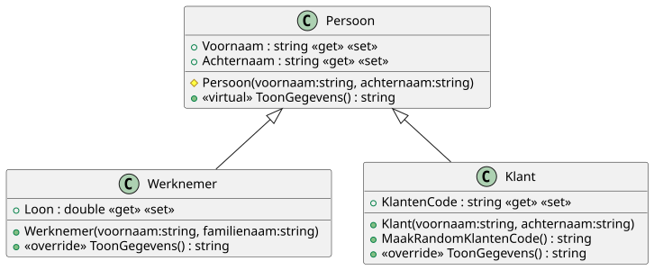
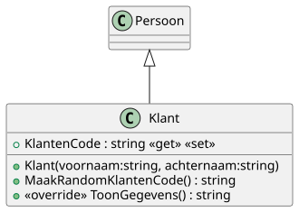
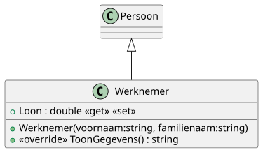

# 04_00

## klassen

### Overzicht



### Persoon


**Methode `ToonGegevens()`**
Geeft de tekstuele voorstelling van het object als volgt
`Mijn naam is <Voornaam> <Achternaam>`

### Klant



**Methode `ToonGegevens()`**
Geeft de tekstuele voorstelling van het object als volgt
`Mijn naam is <Voornaam> <Achternaam> en mijn klanten code is <KlantenCode>`.

**Methode `MaakRandomKlantenCode`**
Deze methode zal een klantencode maken bestaande uit de initialen van de klant gevolgd door een willkeurig getal tussen 1 en 1000. Zorg er voor dat het getal telkens uit 4 cijfers bestaat. Bijvoorbeeld: `JS0050 (John Smith met getal 50).`

**Constructor**
De klantencode wordt ingevuld met een willekeurige klantencode. Maak gebruik van de methode MaakRandomKlantenCode().


### Werknemer



**Methode `ToonGegevens()`**
Geeft de tekstuele voorstelling van het object als volgt
`Mijn naam is <Voornaam> <Achternaam> en ik verdien <Loon> euro per uur.`

**Constructor**
Het loon wordt bij een nieuwe werknemer ingesteld op 10,20 euro.


## Console applicatie
Maak een nieuwe werknemer en klant aan. Geef de werknemer en klant een voor-/achternaam. Print de gegevens van de werknemer en de klant in console via de methode ToonGegevens().

De klantencodes zijn random. Deze kunnen dus verschillen in jouw applicatie.

## Fuzz Test Cases

Below are the automatically generated input/output expectations.

---

### Case 1

**Complete console output:**

```
Werknemer, geef je voornaam:    
Werknemer, geef je voornaam: John
Werknemer, geef je achternaam:    
Werknemer, geef je achternaam: Li
Mijn naam is John Li en ik verdien 10.2 euro per uur.
Klant, geef je voornaam:    
Klant, geef je voornaam: Aïcha
Klant, geef je achternaam:    
Klant, geef je achternaam: Brown
Mijn naam is Aïcha Brown en mijn klanten code is AB0774.
```

**Input:**

```
   
John
   
Li
   
Aïcha
   
Brown
```

**Expected Output:**

```
Mijn naam is John Li en ik verdien 10.2 euro per uur.
Mijn naam is Aïcha Brown en mijn klanten code is AB0774.
```

---

### Case 2

**Complete console output:**

```
Werknemer, geef je voornaam:    
Werknemer, geef je voornaam: Zoë
Werknemer, geef je achternaam:    
Werknemer, geef je achternaam: Van den Berg
Mijn naam is Zoë Van den Berg en ik verdien 10.2 euro per uur.
Klant, geef je voornaam:    
Klant, geef je voornaam: Emma
Klant, geef je achternaam:    
Klant, geef je achternaam: Brown
Mijn naam is Emma Brown en mijn klanten code is EB0165.
```

**Input:**

```
   
Zoë
   
Van den Berg
   
Emma
   
Brown
```

**Expected Output:**

```
Mijn naam is Zoë Van den Berg en ik verdien 10.2 euro per uur.
Mijn naam is Emma Brown en mijn klanten code is EB0165.
```

---

### Case 3

**Complete console output:**

```
Werknemer, geef je voornaam:    
Werknemer, geef je voornaam: Anne-Marie
Werknemer, geef je achternaam:    
Werknemer, geef je achternaam: Smith
Mijn naam is Anne-Marie Smith en ik verdien 10.2 euro per uur.
Klant, geef je voornaam:    
Klant, geef je voornaam: Emma
Klant, geef je achternaam:    
Klant, geef je achternaam: Rossi
Mijn naam is Emma Rossi en mijn klanten code is ER0652.
```

**Input:**

```
   
Anne-Marie
   
Smith
   
Emma
   
Rossi
```

**Expected Output:**

```
Mijn naam is Anne-Marie Smith en ik verdien 10.2 euro per uur.
Mijn naam is Emma Rossi en mijn klanten code is ER0652.
```

---

### Case 4

**Complete console output:**

```
Werknemer, geef je voornaam:    
Werknemer, geef je voornaam: Élodie
Werknemer, geef je achternaam:    
Werknemer, geef je achternaam: Van den Berg
Mijn naam is Élodie Van den Berg en ik verdien 10.2 euro per uur.
Klant, geef je voornaam:    
Klant, geef je voornaam: Mia
Klant, geef je achternaam:    
Klant, geef je achternaam: Dubois
Mijn naam is Mia Dubois en mijn klanten code is MD0474.
```

**Input:**

```
   
Élodie
   
Van den Berg
   
Mia
   
Dubois
```

**Expected Output:**

```
Mijn naam is Élodie Van den Berg en ik verdien 10.2 euro per uur.
Mijn naam is Mia Dubois en mijn klanten code is MD0474.
```

---

### Case 5

**Complete console output:**

```
Werknemer, geef je voornaam:    
Werknemer, geef je voornaam: O'Neil
Werknemer, geef je achternaam:    
Werknemer, geef je achternaam: Peeters
Mijn naam is O'Neil Peeters en ik verdien 10.2 euro per uur.
Klant, geef je voornaam:    
Klant, geef je voornaam: Noah
Klant, geef je achternaam:    
Klant, geef je achternaam: Dubois
Mijn naam is Noah Dubois en mijn klanten code is ND0809.
```

**Input:**

```
   
O'Neil
   
Peeters
   
Noah
   
Dubois
```

**Expected Output:**

```
Mijn naam is O'Neil Peeters en ik verdien 10.2 euro per uur.
Mijn naam is Noah Dubois en mijn klanten code is ND0809.
```

---

### Case 6

**Complete console output:**

```
Werknemer, geef je voornaam:    
Werknemer, geef je voornaam: O'Neil
Werknemer, geef je achternaam:    
Werknemer, geef je achternaam: Janssens
Mijn naam is O'Neil Janssens en ik verdien 10.2 euro per uur.
Klant, geef je voornaam:    
Klant, geef je voornaam: Luca
Klant, geef je achternaam:    
Klant, geef je achternaam: D'Hoore
Mijn naam is Luca D'Hoore en mijn klanten code is LD0328.
```

**Input:**

```
   
O'Neil
   
Janssens
   
Luca
   
D'Hoore
```

**Expected Output:**

```
Mijn naam is O'Neil Janssens en ik verdien 10.2 euro per uur.
Mijn naam is Luca D'Hoore en mijn klanten code is LD0328.
```

---

### Case 7

**Complete console output:**

```
Werknemer, geef je voornaam:    
Werknemer, geef je voornaam: John
Werknemer, geef je achternaam:    
Werknemer, geef je achternaam: Smith
Mijn naam is John Smith en ik verdien 10.2 euro per uur.
Klant, geef je voornaam:    
Klant, geef je voornaam: Noah
Klant, geef je achternaam:    
Klant, geef je achternaam: D'Hoore
Mijn naam is Noah D'Hoore en mijn klanten code is ND0888.
```

**Input:**

```
   
John
   
Smith
   
Noah
   
D'Hoore
```

**Expected Output:**

```
Mijn naam is John Smith en ik verdien 10.2 euro per uur.
Mijn naam is Noah D'Hoore en mijn klanten code is ND0888.
```

---

### Case 8

**Complete console output:**

```
Werknemer, geef je voornaam:    
Werknemer, geef je voornaam: Anne-Marie
Werknemer, geef je achternaam:    
Werknemer, geef je achternaam: Peeters
Mijn naam is Anne-Marie Peeters en ik verdien 10.2 euro per uur.
Klant, geef je voornaam:    
Klant, geef je voornaam: Emma
Klant, geef je achternaam:    
Klant, geef je achternaam: Rossi
Mijn naam is Emma Rossi en mijn klanten code is ER0768.
```

**Input:**

```
   
Anne-Marie
   
Peeters
   
Emma
   
Rossi
```

**Expected Output:**

```
Mijn naam is Anne-Marie Peeters en ik verdien 10.2 euro per uur.
Mijn naam is Emma Rossi en mijn klanten code is ER0768.
```

---

### Case 9

**Complete console output:**

```
Werknemer, geef je voornaam:    
Werknemer, geef je voornaam: John
Werknemer, geef je achternaam:    
Werknemer, geef je achternaam: Van den Berg
Mijn naam is John Van den Berg en ik verdien 10.2 euro per uur.
Klant, geef je voornaam:    
Klant, geef je voornaam: Emma
Klant, geef je achternaam:    
Klant, geef je achternaam: Brown
Mijn naam is Emma Brown en mijn klanten code is EB0942.
```

**Input:**

```
   
John
   
Van den Berg
   
Emma
   
Brown
```

**Expected Output:**

```
Mijn naam is John Van den Berg en ik verdien 10.2 euro per uur.
Mijn naam is Emma Brown en mijn klanten code is EB0942.
```

---

### Case 10

**Complete console output:**

```
Werknemer, geef je voornaam:    
Werknemer, geef je voornaam: Zoë
Werknemer, geef je achternaam:    
Werknemer, geef je achternaam: De Smet
Mijn naam is Zoë De Smet en ik verdien 10.2 euro per uur.
Klant, geef je voornaam:    
Klant, geef je voornaam: Mia
Klant, geef je achternaam:    
Klant, geef je achternaam: Brown
Mijn naam is Mia Brown en mijn klanten code is MB0398.
```

**Input:**

```
   
Zoë
   
De Smet
   
Mia
   
Brown
```

**Expected Output:**

```
Mijn naam is Zoë De Smet en ik verdien 10.2 euro per uur.
Mijn naam is Mia Brown en mijn klanten code is MB0398.
```

---

### Case 11

**Complete console output:**

```
Werknemer, geef je voornaam:    
Werknemer, geef je voornaam: Sofie
Werknemer, geef je achternaam:    
Werknemer, geef je achternaam: Peeters
Mijn naam is Sofie Peeters en ik verdien 10.2 euro per uur.
Klant, geef je voornaam:    
Klant, geef je voornaam: Aïcha
Klant, geef je achternaam:    
Klant, geef je achternaam: Garcia
Mijn naam is Aïcha Garcia en mijn klanten code is AG0832.
```

**Input:**

```
   
Sofie
   
Peeters
   
Aïcha
   
Garcia
```

**Expected Output:**

```
Mijn naam is Sofie Peeters en ik verdien 10.2 euro per uur.
Mijn naam is Aïcha Garcia en mijn klanten code is AG0832.
```

---

### Case 12

**Complete console output:**

```
Werknemer, geef je voornaam:    
Werknemer, geef je voornaam: Zoë
Werknemer, geef je achternaam:    
Werknemer, geef je achternaam: Janssens
Mijn naam is Zoë Janssens en ik verdien 10.2 euro per uur.
Klant, geef je voornaam:    
Klant, geef je voornaam: Mia
Klant, geef je achternaam:    
Klant, geef je achternaam: Khan
Mijn naam is Mia Khan en mijn klanten code is MK0170.
```

**Input:**

```
   
Zoë
   
Janssens
   
Mia
   
Khan
```

**Expected Output:**

```
Mijn naam is Zoë Janssens en ik verdien 10.2 euro per uur.
Mijn naam is Mia Khan en mijn klanten code is MK0170.
```

---

### Case 13

**Complete console output:**

```
Werknemer, geef je voornaam:    
Werknemer, geef je voornaam: Sofie
Werknemer, geef je achternaam:    
Werknemer, geef je achternaam: Van den Berg
Mijn naam is Sofie Van den Berg en ik verdien 10.2 euro per uur.
Klant, geef je voornaam:    
Klant, geef je voornaam: Noah
Klant, geef je achternaam:    
Klant, geef je achternaam: Brown
Mijn naam is Noah Brown en mijn klanten code is NB0977.
```

**Input:**

```
   
Sofie
   
Van den Berg
   
Noah
   
Brown
```

**Expected Output:**

```
Mijn naam is Sofie Van den Berg en ik verdien 10.2 euro per uur.
Mijn naam is Noah Brown en mijn klanten code is NB0977.
```

---

### Case 14

**Complete console output:**

```
Werknemer, geef je voornaam:    
Werknemer, geef je voornaam: O'Neil
Werknemer, geef je achternaam:    
Werknemer, geef je achternaam: Janssens
Mijn naam is O'Neil Janssens en ik verdien 10.2 euro per uur.
Klant, geef je voornaam:    
Klant, geef je voornaam: Sam
Klant, geef je achternaam:    
Klant, geef je achternaam: Rossi
Mijn naam is Sam Rossi en mijn klanten code is SR0257.
```

**Input:**

```
   
O'Neil
   
Janssens
   
Sam
   
Rossi
```

**Expected Output:**

```
Mijn naam is O'Neil Janssens en ik verdien 10.2 euro per uur.
Mijn naam is Sam Rossi en mijn klanten code is SR0257.
```

---

### Case 15

**Complete console output:**

```
Werknemer, geef je voornaam:    
Werknemer, geef je voornaam: Zoë
Werknemer, geef je achternaam:    
Werknemer, geef je achternaam: De Smet
Mijn naam is Zoë De Smet en ik verdien 10.2 euro per uur.
Klant, geef je voornaam:    
Klant, geef je voornaam: Aïcha
Klant, geef je achternaam:    
Klant, geef je achternaam: Khan
Mijn naam is Aïcha Khan en mijn klanten code is AK0106.
```

**Input:**

```
   
Zoë
   
De Smet
   
Aïcha
   
Khan
```

**Expected Output:**

```
Mijn naam is Zoë De Smet en ik verdien 10.2 euro per uur.
Mijn naam is Aïcha Khan en mijn klanten code is AK0106.
```

---
