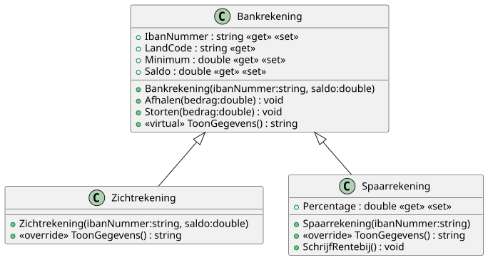

# 04_02

## Klassen



Het saldo mag niet onder minimum komen. Bij foutieve waarde wordt het saldo op het minimum ingesteld.
De landcode geeft de eerste 2 karakters van het iban-nummer terug.
Bij het aanmaken van een spaarrekening, zal standaard een percentage voorzien worden van 5%.
Bij het aanmaken van een zichtrekening, zal er standaard een minimum voorzien worden van 0.

## Console applicatie
Bij het opstarten van het programma krijgt de gebruiker een menu met soorten rekeningen waaruit deze kan kiezen. Bij het ingeven van een optie worden vervolgens benodigde gegevens gevraagd.

## Fuzz Test Cases

Below are the automatically generated input/output expectations.

---

### Case 1

**Complete console output:**

```
1. Spaarekening
2. Zichtrekening
Maak uw keuze: ongeldig
Ongeldige keuze
Maak uw keuze: 2
Geef een IBAN: NL91 ABNA 0417 1643 00
Geef een saldo: -1
Geef een saldo: 250
Rekening NL91 ABNA 0417 1643 00 met saldo 250 (minimum 0)
```

**Input:**

```
ongeldig
2
NL91 ABNA 0417 1643 00
-1
250
```

**Expected Output:**

```
1. Spaarekening
2. Zichtrekening
Ongeldige keuze
Rekening NL91 ABNA 0417 1643 00 met saldo 250 (minimum 0)
```

---

### Case 2

**Complete console output:**

```
1. Spaarekening
2. Zichtrekening
Maak uw keuze: ongeldig
Ongeldige keuze
Maak uw keuze: 2
Geef een IBAN: BE12 1234 1234 1234
Geef een saldo: 0
Rekening BE12 1234 1234 1234 met saldo 0 (minimum 0)
```

**Input:**

```
ongeldig
2
BE12 1234 1234 1234
0
250
```

**Expected Output:**

```
1. Spaarekening
2. Zichtrekening
Ongeldige keuze
Rekening BE12 1234 1234 1234 met saldo 0 (minimum 0)
```

---

### Case 3

**Complete console output:**

```
1. Spaarekening
2. Zichtrekening
Maak uw keuze: ongeldig
Ongeldige keuze
Maak uw keuze: 1
Geef een IBAN: NL91 ABNA 0417 1643 00
Rekening NL91 ABNA 0417 1643 00 met saldo 0 (percentage 5)
```

**Input:**

```
ongeldig
1
NL91 ABNA 0417 1643 00
```

**Expected Output:**

```
1. Spaarekening
2. Zichtrekening
Ongeldige keuze
Rekening NL91 ABNA 0417 1643 00 met saldo 0 (percentage 5)
```

---

### Case 4

**Complete console output:**

```
1. Spaarekening
2. Zichtrekening
Maak uw keuze: ongeldig
Ongeldige keuze
Maak uw keuze: 1
Geef een IBAN: FR14 2004 1010 0505 0001 3M02 606
Rekening FR14 2004 1010 0505 0001 3M02 606 met saldo 0 (percentage 5)
```

**Input:**

```
ongeldig
1
FR14 2004 1010 0505 0001 3M02 606
```

**Expected Output:**

```
1. Spaarekening
2. Zichtrekening
Ongeldige keuze
Rekening FR14 2004 1010 0505 0001 3M02 606 met saldo 0 (percentage 5)
```

---

### Case 5

**Complete console output:**

```
1. Spaarekening
2. Zichtrekening
Maak uw keuze: ongeldig
Ongeldige keuze
Maak uw keuze: 2
Geef een IBAN: FR14 2004 1010 0505 0001 3M02 606
Geef een saldo: 250
Rekening FR14 2004 1010 0505 0001 3M02 606 met saldo 250 (minimum 0)
```

**Input:**

```
ongeldig
2
FR14 2004 1010 0505 0001 3M02 606
250
250
```

**Expected Output:**

```
1. Spaarekening
2. Zichtrekening
Ongeldige keuze
Rekening FR14 2004 1010 0505 0001 3M02 606 met saldo 250 (minimum 0)
```

---

### Case 6

**Complete console output:**

```
1. Spaarekening
2. Zichtrekening
Maak uw keuze: ongeldig
Ongeldige keuze
Maak uw keuze: 2
Geef een IBAN: DE89 3704 0044 0532 0130 00
Geef een saldo: -1
Geef een saldo: 250
Rekening DE89 3704 0044 0532 0130 00 met saldo 250 (minimum 0)
```

**Input:**

```
ongeldig
2
DE89 3704 0044 0532 0130 00
-1
250
```

**Expected Output:**

```
1. Spaarekening
2. Zichtrekening
Ongeldige keuze
Rekening DE89 3704 0044 0532 0130 00 met saldo 250 (minimum 0)
```

---

### Case 7

**Complete console output:**

```
1. Spaarekening
2. Zichtrekening
Maak uw keuze: ongeldig
Ongeldige keuze
Maak uw keuze: 2
Geef een IBAN: FR14 2004 1010 0505 0001 3M02 606
Geef een saldo: 0
Rekening FR14 2004 1010 0505 0001 3M02 606 met saldo 0 (minimum 0)
```

**Input:**

```
ongeldig
2
FR14 2004 1010 0505 0001 3M02 606
0
250
```

**Expected Output:**

```
1. Spaarekening
2. Zichtrekening
Ongeldige keuze
Rekening FR14 2004 1010 0505 0001 3M02 606 met saldo 0 (minimum 0)
```

---

### Case 8

**Complete console output:**

```
1. Spaarekening
2. Zichtrekening
Maak uw keuze: ongeldig
Ongeldige keuze
Maak uw keuze: 2
Geef een IBAN: DE89 3704 0044 0532 0130 00
Geef een saldo: 1
Rekening DE89 3704 0044 0532 0130 00 met saldo 1 (minimum 0)
```

**Input:**

```
ongeldig
2
DE89 3704 0044 0532 0130 00
1
250
```

**Expected Output:**

```
1. Spaarekening
2. Zichtrekening
Ongeldige keuze
Rekening DE89 3704 0044 0532 0130 00 met saldo 1 (minimum 0)
```

---

### Case 9

**Complete console output:**

```
1. Spaarekening
2. Zichtrekening
Maak uw keuze: ongeldig
Ongeldige keuze
Maak uw keuze: 1
Geef een IBAN: FR14 2004 1010 0505 0001 3M02 606
Rekening FR14 2004 1010 0505 0001 3M02 606 met saldo 0 (percentage 5)
```

**Input:**

```
ongeldig
1
FR14 2004 1010 0505 0001 3M02 606
```

**Expected Output:**

```
1. Spaarekening
2. Zichtrekening
Ongeldige keuze
Rekening FR14 2004 1010 0505 0001 3M02 606 met saldo 0 (percentage 5)
```

---

### Case 10

**Complete console output:**

```
1. Spaarekening
2. Zichtrekening
Maak uw keuze: ongeldig
Ongeldige keuze
Maak uw keuze: 1
Geef een IBAN: FR14 2004 1010 0505 0001 3M02 606
Rekening FR14 2004 1010 0505 0001 3M02 606 met saldo 0 (percentage 5)
```

**Input:**

```
ongeldig
1
FR14 2004 1010 0505 0001 3M02 606
```

**Expected Output:**

```
1. Spaarekening
2. Zichtrekening
Ongeldige keuze
Rekening FR14 2004 1010 0505 0001 3M02 606 met saldo 0 (percentage 5)
```

---

### Case 11

**Complete console output:**

```
1. Spaarekening
2. Zichtrekening
Maak uw keuze: ongeldig
Ongeldige keuze
Maak uw keuze: 2
Geef een IBAN: DE89 3704 0044 0532 0130 00
Geef een saldo: 1
Rekening DE89 3704 0044 0532 0130 00 met saldo 1 (minimum 0)
```

**Input:**

```
ongeldig
2
DE89 3704 0044 0532 0130 00
1
250
```

**Expected Output:**

```
1. Spaarekening
2. Zichtrekening
Ongeldige keuze
Rekening DE89 3704 0044 0532 0130 00 met saldo 1 (minimum 0)
```

---

### Case 12

**Complete console output:**

```
1. Spaarekening
2. Zichtrekening
Maak uw keuze: ongeldig
Ongeldige keuze
Maak uw keuze: 2
Geef een IBAN: FR14 2004 1010 0505 0001 3M02 606
Geef een saldo: ongeldig
Ongeldig saldo
Rekening FR14 2004 1010 0505 0001 3M02 606 met saldo 0 (minimum 0)
```

**Input:**

```
ongeldig
2
FR14 2004 1010 0505 0001 3M02 606
ongeldig
250
```

**Expected Output:**

```
1. Spaarekening
2. Zichtrekening
Ongeldige keuze
Ongeldig saldo
Rekening FR14 2004 1010 0505 0001 3M02 606 met saldo 0 (minimum 0)
```

---

### Case 13

**Complete console output:**

```
1. Spaarekening
2. Zichtrekening
Maak uw keuze: ongeldig
Ongeldige keuze
Maak uw keuze: 2
Geef een IBAN: FR14 2004 1010 0505 0001 3M02 606
Geef een saldo: 250
Rekening FR14 2004 1010 0505 0001 3M02 606 met saldo 250 (minimum 0)
```

**Input:**

```
ongeldig
2
FR14 2004 1010 0505 0001 3M02 606
250
250
```

**Expected Output:**

```
1. Spaarekening
2. Zichtrekening
Ongeldige keuze
Rekening FR14 2004 1010 0505 0001 3M02 606 met saldo 250 (minimum 0)
```

---

### Case 14

**Complete console output:**

```
1. Spaarekening
2. Zichtrekening
Maak uw keuze: ongeldig
Ongeldige keuze
Maak uw keuze: 2
Geef een IBAN: DE89 3704 0044 0532 0130 00
Geef een saldo: ongeldig
Ongeldig saldo
Rekening DE89 3704 0044 0532 0130 00 met saldo 0 (minimum 0)
```

**Input:**

```
ongeldig
2
DE89 3704 0044 0532 0130 00
ongeldig
250
```

**Expected Output:**

```
1. Spaarekening
2. Zichtrekening
Ongeldige keuze
Ongeldig saldo
Rekening DE89 3704 0044 0532 0130 00 met saldo 0 (minimum 0)
```

---

### Case 15

**Complete console output:**

```
1. Spaarekening
2. Zichtrekening
Maak uw keuze: ongeldig
Ongeldige keuze
Maak uw keuze: 1
Geef een IBAN: FR14 2004 1010 0505 0001 3M02 606
Rekening FR14 2004 1010 0505 0001 3M02 606 met saldo 0 (percentage 5)
```

**Input:**

```
ongeldig
1
FR14 2004 1010 0505 0001 3M02 606
```

**Expected Output:**

```
1. Spaarekening
2. Zichtrekening
Ongeldige keuze
Rekening FR14 2004 1010 0505 0001 3M02 606 met saldo 0 (percentage 5)
```

---
