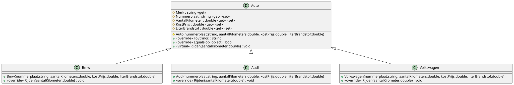
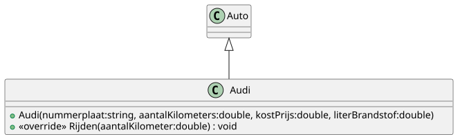
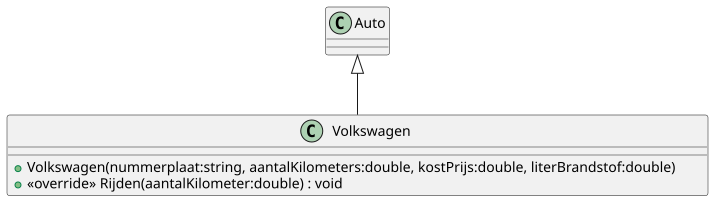

# 05_00

## Klassen



### Auto


**Methode `ToString()`**

Geeft de tekstuele voorstelling van het object als volgt:
Ik ben een <Merk> met nummerplaat <Nummerplaat> (<AantalKilometer> km - <LiterBrandstof> liter)
Kostprijs: <Kostprijs> euro

**Property `Merk`**

Dit geeft als returnwaarde de tekstuele waarde
<klassenaam>

Tip: De klassenaam is op te vragen door de methode this.GetType().Name

**Methode `Equals(Object obj)`**

Een auto is gelijk aan een andere kaart als beide een van het type auto zijn alsook dezelfde nummerplaat bevatten.

**Methode `Rijden(double aantalKilometer)`**

Deze methode zal kilometers toevoegen aan het totale aantal en vervolgens de hoeveelheid brandstof verrekenen waarbij er bij 20 kilometer 1 liter verbruikt is.

### Audi



**Constructor**

Maak gebruik van de constructor van de superklasse.

**Methode `Rijden(double aantalKilometer)`**

Deze methode zal kilometers toevoegen aan het totale aantal en vervolgens de hoeveelheid brandstof verrekenen waarbij er bij 15 kilometer 1 liter verbruikt is.

### BMW


**Constructor**

Maak gebruik van de constructor van de superklasse.

**Methode `Rijden(double aantalKilometer)`**

Deze methode zal kilometers toevoegen aan het totale aantal en vervolgens de hoeveelheid brandstof verrekenen waarbij er bij 20 kilometer 1 liter verbruikt is.


### Volkswagen



**Constructor**

Maak gebruik van de constructor van de superklasse.

**Methode `Rijden(double aantalKilometer)`**

Deze methode zal kilometers toevoegen aan het totale aantal en vervolgens de hoeveelheid brandstof verrekenen waarbij er bij 25 kilometer 1 liter verbruikt is.

## Console applicatie

Bij het opstarten van de applicatie, kan de gebruiker 1 van de auto's kiezen om acties op uit te voeren. Hierna wordt gevraagd welke actie zij willen uitvoeren. Hierbij worden de juiste gegevens opgevraagd om deze actie uit te voeren. De applicatie blijft actief tot optie 1 gekozen word.

Maak volgende auto's aan:

- Audi met nummerplaat 1-lvn-568, 25000 km en 25 liter brandstof. Kostprijs: 7500 euro.
- Volkswagen met nummerplaat 1-sej-454, 100000 km en 10 liter brandstof. Kostprijs: 5500 euro.
- Bmw met nummerplaat 1-hbj-298, 500 km en 44 liter brandstof. Kostprijs: 12500 euro.

## Fuzz Test Cases

Below are the automatically generated input/output expectations.

---

### Case 1

**Complete console output:**

```
Kies een optie:
1. Stoppen
2. Audi (1-lvn-568)
3. Volkswagen (1-sej-454)
4. BMW (1-hbj-298)
2
Kies een optie:
1. Testrit maken
2. Details tonen
1
Geef aantal kilometer: 
1500
Kies een optie:
1. Stoppen
2. Audi (1-lvn-568)
3. Volkswagen (1-sej-454)
4. BMW (1-hbj-298)
1
Bedankt en tot ziens!
```

**Input:**

```
2
1
1500
1
```

**Expected Output:**

```
Bedankt en tot ziens!
```

---

### Case 2

**Complete console output:**

```
Kies een optie:
1. Stoppen
2. Audi (1-lvn-568)
3. Volkswagen (1-sej-454)
4. BMW (1-hbj-298)
4
Kies een optie:
1. Testrit maken
2. Details tonen
1
Geef aantal kilometer: 
1500
Kies een optie:
1. Stoppen
2. Audi (1-lvn-568)
3. Volkswagen (1-sej-454)
4. BMW (1-hbj-298)
1
Bedankt en tot ziens!
```

**Input:**

```
4
1
1500
1
```

**Expected Output:**

```
Bedankt en tot ziens!
```

---

### Case 3

**Complete console output:**

```
Kies een optie:
1. Stoppen
2. Audi (1-lvn-568)
3. Volkswagen (1-sej-454)
4. BMW (1-hbj-298)
4
Kies een optie:
1. Testrit maken
2. Details tonen
1
Geef aantal kilometer: 
500
Kies een optie:
1. Stoppen
2. Audi (1-lvn-568)
3. Volkswagen (1-sej-454)
4. BMW (1-hbj-298)
3
Kies een optie:
1. Testrit maken
2. Details tonen
2
Ik ben een Volkswagen met nummerplaat 1-sej-454 (100000 km - 10.00 liter)
Kostprijs: 5500 euro
Kies een optie:
1. Stoppen
2. Audi (1-lvn-568)
3. Volkswagen (1-sej-454)
4. BMW (1-hbj-298)
2
Kies een optie:
1. Testrit maken
2. Details tonen
2
Ik ben een Audi met nummerplaat 1-lvn-568 (25000 km - 25.00 liter)
Kostprijs: 7500 euro
Kies een optie:
1. Stoppen
2. Audi (1-lvn-568)
3. Volkswagen (1-sej-454)
4. BMW (1-hbj-298)
1
Bedankt en tot ziens!
```

**Input:**

```
4
1
500
3
2
2
2
1
```

**Expected Output:**

```
Ik ben een Volkswagen met nummerplaat 1-sej-454 (100000 km - 10.00 liter)
Kostprijs: 5500 euro
Ik ben een Audi met nummerplaat 1-lvn-568 (25000 km - 25.00 liter)
Kostprijs: 7500 euro
Bedankt en tot ziens!
```

---

### Case 4

**Complete console output:**

```
Kies een optie:
1. Stoppen
2. Audi (1-lvn-568)
3. Volkswagen (1-sej-454)
4. BMW (1-hbj-298)
3
Kies een optie:
1. Testrit maken
2. Details tonen
1
Geef aantal kilometer: 
2500
Kies een optie:
1. Stoppen
2. Audi (1-lvn-568)
3. Volkswagen (1-sej-454)
4. BMW (1-hbj-298)
1
Bedankt en tot ziens!
```

**Input:**

```
3
1
2500
1
```

**Expected Output:**

```
Bedankt en tot ziens!
```

---

### Case 5

**Complete console output:**

```
Kies een optie:
1. Stoppen
2. Audi (1-lvn-568)
3. Volkswagen (1-sej-454)
4. BMW (1-hbj-298)
2
Kies een optie:
1. Testrit maken
2. Details tonen
1
Geef aantal kilometer: 
1500
Kies een optie:
1. Stoppen
2. Audi (1-lvn-568)
3. Volkswagen (1-sej-454)
4. BMW (1-hbj-298)
3
Kies een optie:
1. Testrit maken
2. Details tonen
2
Ik ben een Volkswagen met nummerplaat 1-sej-454 (100000 km - 10.00 liter)
Kostprijs: 5500 euro
Kies een optie:
1. Stoppen
2. Audi (1-lvn-568)
3. Volkswagen (1-sej-454)
4. BMW (1-hbj-298)
1
Bedankt en tot ziens!
```

**Input:**

```
2
1
1500
3
2
1
```

**Expected Output:**

```
Ik ben een Volkswagen met nummerplaat 1-sej-454 (100000 km - 10.00 liter)
Kostprijs: 5500 euro
Bedankt en tot ziens!
```

---

### Case 6

**Complete console output:**

```
Kies een optie:
1. Stoppen
2. Audi (1-lvn-568)
3. Volkswagen (1-sej-454)
4. BMW (1-hbj-298)
3
Kies een optie:
1. Testrit maken
2. Details tonen
1
Geef aantal kilometer: 
2500
Kies een optie:
1. Stoppen
2. Audi (1-lvn-568)
3. Volkswagen (1-sej-454)
4. BMW (1-hbj-298)
4
Kies een optie:
1. Testrit maken
2. Details tonen
2
Ik ben een Bmw met nummerplaat 1-hbj-298 (500 km - 44.00 liter)
Kostprijs: 12500 euro
Kies een optie:
1. Stoppen
2. Audi (1-lvn-568)
3. Volkswagen (1-sej-454)
4. BMW (1-hbj-298)
4
Kies een optie:
1. Testrit maken
2. Details tonen
2
Ik ben een Bmw met nummerplaat 1-hbj-298 (500 km - 44.00 liter)
Kostprijs: 12500 euro
Kies een optie:
1. Stoppen
2. Audi (1-lvn-568)
3. Volkswagen (1-sej-454)
4. BMW (1-hbj-298)
1
Bedankt en tot ziens!
```

**Input:**

```
3
1
2500
4
2
4
2
1
```

**Expected Output:**

```
Ik ben een Bmw met nummerplaat 1-hbj-298 (500 km - 44.00 liter)
Kostprijs: 12500 euro
Ik ben een Bmw met nummerplaat 1-hbj-298 (500 km - 44.00 liter)
Kostprijs: 12500 euro
Bedankt en tot ziens!
```

---

### Case 7

**Complete console output:**

```
Kies een optie:
1. Stoppen
2. Audi (1-lvn-568)
3. Volkswagen (1-sej-454)
4. BMW (1-hbj-298)
3
Kies een optie:
1. Testrit maken
2. Details tonen
1
Geef aantal kilometer: 
1500
Kies een optie:
1. Stoppen
2. Audi (1-lvn-568)
3. Volkswagen (1-sej-454)
4. BMW (1-hbj-298)
3
Kies een optie:
1. Testrit maken
2. Details tonen
1
Geef aantal kilometer: 
2500
Kies een optie:
1. Stoppen
2. Audi (1-lvn-568)
3. Volkswagen (1-sej-454)
4. BMW (1-hbj-298)
2
Kies een optie:
1. Testrit maken
2. Details tonen
1
Geef aantal kilometer: 
2500
Kies een optie:
1. Stoppen
2. Audi (1-lvn-568)
3. Volkswagen (1-sej-454)
4. BMW (1-hbj-298)
1
Bedankt en tot ziens!
```

**Input:**

```
3
1
1500
3
1
2500
2
1
2500
1
```

**Expected Output:**

```
Bedankt en tot ziens!
```

---

### Case 8

**Complete console output:**

```
Kies een optie:
1. Stoppen
2. Audi (1-lvn-568)
3. Volkswagen (1-sej-454)
4. BMW (1-hbj-298)
4
Kies een optie:
1. Testrit maken
2. Details tonen
1
Geef aantal kilometer: 
1500
Kies een optie:
1. Stoppen
2. Audi (1-lvn-568)
3. Volkswagen (1-sej-454)
4. BMW (1-hbj-298)
3
Kies een optie:
1. Testrit maken
2. Details tonen
2
Ik ben een Volkswagen met nummerplaat 1-sej-454 (100000 km - 10.00 liter)
Kostprijs: 5500 euro
Kies een optie:
1. Stoppen
2. Audi (1-lvn-568)
3. Volkswagen (1-sej-454)
4. BMW (1-hbj-298)
4
Kies een optie:
1. Testrit maken
2. Details tonen
2
Ik ben een Bmw met nummerplaat 1-hbj-298 (2000 km - -31.00 liter)
Kostprijs: 12500 euro
Kies een optie:
1. Stoppen
2. Audi (1-lvn-568)
3. Volkswagen (1-sej-454)
4. BMW (1-hbj-298)
1
Bedankt en tot ziens!
```

**Input:**

```
4
1
1500
3
2
4
2
1
```

**Expected Output:**

```
Ik ben een Volkswagen met nummerplaat 1-sej-454 (100000 km - 10.00 liter)
Kostprijs: 5500 euro
Ik ben een Bmw met nummerplaat 1-hbj-298 (2000 km - -31.00 liter)
Kostprijs: 12500 euro
Bedankt en tot ziens!
```

---

### Case 9

**Complete console output:**

```
Kies een optie:
1. Stoppen
2. Audi (1-lvn-568)
3. Volkswagen (1-sej-454)
4. BMW (1-hbj-298)
3
Kies een optie:
1. Testrit maken
2. Details tonen
2
Ik ben een Volkswagen met nummerplaat 1-sej-454 (100000 km - 10.00 liter)
Kostprijs: 5500 euro
Kies een optie:
1. Stoppen
2. Audi (1-lvn-568)
3. Volkswagen (1-sej-454)
4. BMW (1-hbj-298)
3
Kies een optie:
1. Testrit maken
2. Details tonen
1
Geef aantal kilometer: 
500
Kies een optie:
1. Stoppen
2. Audi (1-lvn-568)
3. Volkswagen (1-sej-454)
4. BMW (1-hbj-298)
3
Kies een optie:
1. Testrit maken
2. Details tonen
1
Geef aantal kilometer: 
500
Kies een optie:
1. Stoppen
2. Audi (1-lvn-568)
3. Volkswagen (1-sej-454)
4. BMW (1-hbj-298)
1
Bedankt en tot ziens!
```

**Input:**

```
3
2
3
1
500
3
1
500
1
```

**Expected Output:**

```
Ik ben een Volkswagen met nummerplaat 1-sej-454 (100000 km - 10.00 liter)
Kostprijs: 5500 euro
Bedankt en tot ziens!
```

---

### Case 10

**Complete console output:**

```
Kies een optie:
1. Stoppen
2. Audi (1-lvn-568)
3. Volkswagen (1-sej-454)
4. BMW (1-hbj-298)
4
Kies een optie:
1. Testrit maken
2. Details tonen
1
Geef aantal kilometer: 
2500
Kies een optie:
1. Stoppen
2. Audi (1-lvn-568)
3. Volkswagen (1-sej-454)
4. BMW (1-hbj-298)
1
Bedankt en tot ziens!
```

**Input:**

```
4
1
2500
1
```

**Expected Output:**

```
Bedankt en tot ziens!
```

---

### Case 11

**Complete console output:**

```
Kies een optie:
1. Stoppen
2. Audi (1-lvn-568)
3. Volkswagen (1-sej-454)
4. BMW (1-hbj-298)
2
Kies een optie:
1. Testrit maken
2. Details tonen
1
Geef aantal kilometer: 
1500
Kies een optie:
1. Stoppen
2. Audi (1-lvn-568)
3. Volkswagen (1-sej-454)
4. BMW (1-hbj-298)
4
Kies een optie:
1. Testrit maken
2. Details tonen
1
Geef aantal kilometer: 
500
Kies een optie:
1. Stoppen
2. Audi (1-lvn-568)
3. Volkswagen (1-sej-454)
4. BMW (1-hbj-298)
3
Kies een optie:
1. Testrit maken
2. Details tonen
2
Ik ben een Volkswagen met nummerplaat 1-sej-454 (100000 km - 10.00 liter)
Kostprijs: 5500 euro
Kies een optie:
1. Stoppen
2. Audi (1-lvn-568)
3. Volkswagen (1-sej-454)
4. BMW (1-hbj-298)
1
Bedankt en tot ziens!
```

**Input:**

```
2
1
1500
4
1
500
3
2
1
```

**Expected Output:**

```
Ik ben een Volkswagen met nummerplaat 1-sej-454 (100000 km - 10.00 liter)
Kostprijs: 5500 euro
Bedankt en tot ziens!
```

---

### Case 12

**Complete console output:**

```
Kies een optie:
1. Stoppen
2. Audi (1-lvn-568)
3. Volkswagen (1-sej-454)
4. BMW (1-hbj-298)
4
Kies een optie:
1. Testrit maken
2. Details tonen
2
Ik ben een Bmw met nummerplaat 1-hbj-298 (500 km - 44.00 liter)
Kostprijs: 12500 euro
Kies een optie:
1. Stoppen
2. Audi (1-lvn-568)
3. Volkswagen (1-sej-454)
4. BMW (1-hbj-298)
3
Kies een optie:
1. Testrit maken
2. Details tonen
2
Ik ben een Volkswagen met nummerplaat 1-sej-454 (100000 km - 10.00 liter)
Kostprijs: 5500 euro
Kies een optie:
1. Stoppen
2. Audi (1-lvn-568)
3. Volkswagen (1-sej-454)
4. BMW (1-hbj-298)
1
Bedankt en tot ziens!
```

**Input:**

```
4
2
3
2
1
```

**Expected Output:**

```
Ik ben een Bmw met nummerplaat 1-hbj-298 (500 km - 44.00 liter)
Kostprijs: 12500 euro
Ik ben een Volkswagen met nummerplaat 1-sej-454 (100000 km - 10.00 liter)
Kostprijs: 5500 euro
Bedankt en tot ziens!
```

---
