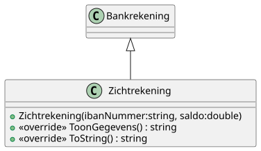

# 05_01

Deze oefening is een uitbreiding op oefening 04.02

## Klassen


### Bankrekening


**Property `LandCode`**

Geeft de eerste 2 karakters van het IbanNummer terug. Bijvoorbeeld BE voor het IbanNummer BE12 3456 7890 1234

**Methode `ToString()`**

Geeft de tekstuele voorstelling van het object als volgt
<IbanNummer> -> Je huidig saldo bedraagt: <Saldo> euro.

### Spaarrekening


**Constructor**

Het percentage krijgt eens standaardwaarde van 15

**Methode `ToString()`**

Geeft de tekstuele voorstelling van het object als volgt <IbanNummer> -> Je huidig saldo bedraagt: <Saldo> euro.
De rentevoet bedraagt: <Percentage>%.

### Zichtrekening



**Methode `ToString()`**

Geeft de tekstuele voorstelling van het object als volgt
<IbanNummer> -> Je hudig saldo bedraagt: <Saldo> euro.
Het minimumbedrag bedraagt: <Minimum> euro.

## Console applicatie

Bij het opstarten van de applicatie krijgt de gebruiker een menu met de volgende opties:

```
1. Spaarrekening
2. Zichtrekening
```

Afhankelijk van de keuze wordt er een respectievelijk object aangemaakt.

De gebruiker krijgt dan 4 opties:

```
1. Afhalen
2. Storten
3. Schrijf rente bij
4. Informatie
```

### Optie `Afhalen`

Vraag hoeveel de gebruiker wil afhalen. Als het bedrag kleiner of gelijk is aan 0, tonen we: "Het af te halen bedrag moet groter zijn dan 0".

Het saldo mag niet onder het minumum komen. Indien dit het geval zou zijn tonen we: "Je hebt niet genoeg saldo om deze opdracht te verwerken...".

Als bovenstaande creteria niet het geval zijn, halen we het bedrag van ons saldo.

### Optie `Storten`

Vraag hoeveel de gebruiker wil storten. Als het bedrag kleiner of gelijk is aan 0, tonen we: "Het te storten bedrag moet groter zijn dan 0". Als bovenstaande creteria niet het geval zijn, storten we het bedrag bij ons saldo.

### Optie `Schrijf rente bij`

Rente bijschrijven kan alleen als de rekening van het type Spaarrekening is.

Is dat niet het geval dan tonen we: "Deze optie is alleen beschikbaar bij een spaarrekening..."

### Optie `Informatie`

Toon een tekstuele waarde van de rekening. Gebruik hiervoor de ToString() methode.

De applicatie sluit af na deze operatie.

## Fuzz Test Cases

Below are the automatically generated input/output expectations.

---

### Case 1

**Complete console output:**

```
Kies een optie:
1. Spaarrekening
2. Zichtrekening

Kies een optie:
1. Afhalen
2. Storten
3. Schijf rente bij
4. Informatie

Hoeveel wil je afhalen? 
2
Je hebt niet genoeg saldo om deze opdracht te verwerken...
Kies een optie:
1. Afhalen
2. Storten
3. Schijf rente bij
4. Informatie

Hoeveel wil je storten? 
1
Kies een optie:
1. Afhalen
2. Storten
3. Schijf rente bij
4. Informatie

BE12 3456 7890 1234 -> Je huidig saldo bedraagt 3 euro
Het minimumbedrag bedraagt: -100 euro
```

**Input:**

```
2
1
864
2
3
4
```

**Expected Output:**

```
Je hebt niet genoeg saldo om deze opdracht te verwerken...
BE12 3456 7890 1234 -> Je huidig saldo bedraagt 3 euro
Het minimumbedrag bedraagt: -100 euro
```

---

### Case 2

**Complete console output:**

```
Kies een optie:
1. Spaarrekening
2. Zichtrekening

Kies een optie:
1. Afhalen
2. Storten
3. Schijf rente bij
4. Informatie

Kies een optie:
1. Afhalen
2. Storten
3. Schijf rente bij
4. Informatie

Hoeveel wil je storten? 
1
Kies een optie:
1. Afhalen
2. Storten
3. Schijf rente bij
4. Informatie

Hoeveel wil je afhalen? 
3
Kies een optie:
1. Afhalen
2. Storten
3. Schijf rente bij
4. Informatie


BE12 3456 7890 1234 -> Je huidig saldo bedraagt 1 euro
De rentevoet bedraagt: 15%
```

**Input:**

```
1
3
2
3
1
2
16
4
```

**Expected Output:**

```
BE12 3456 7890 1234 -> Je huidig saldo bedraagt 1 euro
De rentevoet bedraagt: 15%
```

---

### Case 3

**Complete console output:**

```
Kies een optie:
1. Spaarrekening
2. Zichtrekening

Kies een optie:
1. Afhalen
2. Storten
3. Schijf rente bij
4. Informatie

Deze optie is alleen beschikbaar bij een spaarrekening...
Kies een optie:
1. Afhalen
2. Storten
3. Schijf rente bij
4. Informatie

Hoeveel wil je storten? 
2
Kies een optie:
1. Afhalen
2. Storten
3. Schijf rente bij
4. Informatie


Hoeveel wil je afhalen? 
3
Kies een optie:
1. Afhalen
2. Storten
3. Schijf rente bij
4. Informatie


Hoeveel wil je afhalen? 
2
Kies een optie:
1. Afhalen
2. Storten
3. Schijf rente bij
4. Informatie

BE12 3456 7890 1234 -> Je huidig saldo bedraagt -3 euro
Het minimumbedrag bedraagt: -100 euro
```

**Input:**

```
2
3
2
1
294
1
1
275
1
3
4
```

**Expected Output:**

```
Deze optie is alleen beschikbaar bij een spaarrekening...
BE12 3456 7890 1234 -> Je huidig saldo bedraagt -3 euro
Het minimumbedrag bedraagt: -100 euro
```

---

### Case 4

**Complete console output:**

```
Kies een optie:
1. Spaarrekening
2. Zichtrekening

Kies een optie:
1. Afhalen
2. Storten
3. Schijf rente bij
4. Informatie

Deze optie is alleen beschikbaar bij een spaarrekening...
Kies een optie:
1. Afhalen
2. Storten
3. Schijf rente bij
4. Informatie

Hoeveel wil je storten? 
2
Kies een optie:
1. Afhalen
2. Storten
3. Schijf rente bij
4. Informatie

Hoeveel wil je storten? 
3
Kies een optie:
1. Afhalen
2. Storten
3. Schijf rente bij
4. Informatie


BE12 3456 7890 1234 -> Je huidig saldo bedraagt 5 euro
Het minimumbedrag bedraagt: -100 euro
```

**Input:**

```
2
3
2
3
2
2
347
4
```

**Expected Output:**

```
Deze optie is alleen beschikbaar bij een spaarrekening...
BE12 3456 7890 1234 -> Je huidig saldo bedraagt 5 euro
Het minimumbedrag bedraagt: -100 euro
```

---

### Case 5

**Complete console output:**

```
Kies een optie:
1. Spaarrekening
2. Zichtrekening

Kies een optie:
1. Afhalen
2. Storten
3. Schijf rente bij
4. Informatie

Deze optie is alleen beschikbaar bij een spaarrekening...
Kies een optie:
1. Afhalen
2. Storten
3. Schijf rente bij
4. Informatie

Hoeveel wil je afhalen? 
2
Kies een optie:
1. Afhalen
2. Storten
3. Schijf rente bij
4. Informatie


Hoeveel wil je afhalen? 
3
Kies een optie:
1. Afhalen
2. Storten
3. Schijf rente bij
4. Informatie


Hoeveel wil je afhalen? 
1
Kies een optie:
1. Afhalen
2. Storten
3. Schijf rente bij
4. Informatie

BE12 3456 7890 1234 -> Je huidig saldo bedraagt -5 euro
Het minimumbedrag bedraagt: -100 euro
```

**Input:**

```
2
3
1
1
542
1
1
968
1
3
4
```

**Expected Output:**

```
Deze optie is alleen beschikbaar bij een spaarrekening...
BE12 3456 7890 1234 -> Je huidig saldo bedraagt -5 euro
Het minimumbedrag bedraagt: -100 euro
```

---

### Case 6

**Complete console output:**

```
Kies een optie:
1. Spaarrekening
2. Zichtrekening

Kies een optie:
1. Afhalen
2. Storten
3. Schijf rente bij
4. Informatie

Kies een optie:
1. Afhalen
2. Storten
3. Schijf rente bij
4. Informatie

Hoeveel wil je storten? 
1
Kies een optie:
1. Afhalen
2. Storten
3. Schijf rente bij
4. Informatie


BE12 3456 7890 1234 -> Je huidig saldo bedraagt 1 euro
De rentevoet bedraagt: 15%
```

**Input:**

```
1
3
2
1
13
4
```

**Expected Output:**

```
BE12 3456 7890 1234 -> Je huidig saldo bedraagt 1 euro
De rentevoet bedraagt: 15%
```

---

### Case 7

**Complete console output:**

```
Kies een optie:
1. Spaarrekening
2. Zichtrekening

Kies een optie:
1. Afhalen
2. Storten
3. Schijf rente bij
4. Informatie

Hoeveel wil je storten? 
1
Kies een optie:
1. Afhalen
2. Storten
3. Schijf rente bij
4. Informatie

Hoeveel wil je storten? 
2
Kies een optie:
1. Afhalen
2. Storten
3. Schijf rente bij
4. Informatie


BE12 3456 7890 1234 -> Je huidig saldo bedraagt 731 euro
De rentevoet bedraagt: 15%
```

**Input:**

```
1
2
729
2
2
494
4
```

**Expected Output:**

```
BE12 3456 7890 1234 -> Je huidig saldo bedraagt 731 euro
De rentevoet bedraagt: 15%
```

---

### Case 8

**Complete console output:**

```
Kies een optie:
1. Spaarrekening
2. Zichtrekening

Kies een optie:
1. Afhalen
2. Storten
3. Schijf rente bij
4. Informatie

Hoeveel wil je afhalen? 
1
Je hebt niet genoeg saldo om deze opdracht te verwerken...
Kies een optie:
1. Afhalen
2. Storten
3. Schijf rente bij
4. Informatie

Hoeveel wil je storten? 
1
Kies een optie:
1. Afhalen
2. Storten
3. Schijf rente bij
4. Informatie


BE12 3456 7890 1234 -> Je huidig saldo bedraagt 2 euro
De rentevoet bedraagt: 15%
```

**Input:**

```
1
1
818
2
2
28
4
```

**Expected Output:**

```
Je hebt niet genoeg saldo om deze opdracht te verwerken...
BE12 3456 7890 1234 -> Je huidig saldo bedraagt 2 euro
De rentevoet bedraagt: 15%
```

---

### Case 9

**Complete console output:**

```
Kies een optie:
1. Spaarrekening
2. Zichtrekening

Kies een optie:
1. Afhalen
2. Storten
3. Schijf rente bij
4. Informatie

Hoeveel wil je afhalen? 
1
Je hebt niet genoeg saldo om deze opdracht te verwerken...
Kies een optie:
1. Afhalen
2. Storten
3. Schijf rente bij
4. Informatie

BE12 3456 7890 1234 -> Je huidig saldo bedraagt 0 euro
De rentevoet bedraagt: 15%
```

**Input:**

```
1
1
155
4
```

**Expected Output:**

```
Je hebt niet genoeg saldo om deze opdracht te verwerken...
BE12 3456 7890 1234 -> Je huidig saldo bedraagt 0 euro
De rentevoet bedraagt: 15%
```

---

### Case 10

**Complete console output:**

```
Kies een optie:
1. Spaarrekening
2. Zichtrekening

Kies een optie:
1. Afhalen
2. Storten
3. Schijf rente bij
4. Informatie

Hoeveel wil je storten? 
2
Kies een optie:
1. Afhalen
2. Storten
3. Schijf rente bij
4. Informatie

Hoeveel wil je afhalen? 
2
Kies een optie:
1. Afhalen
2. Storten
3. Schijf rente bij
4. Informatie


Hoeveel wil je afhalen? 
208
Kies een optie:
1. Afhalen
2. Storten
3. Schijf rente bij
4. Informatie


Hoeveel wil je storten? 
1
Kies een optie:
1. Afhalen
2. Storten
3. Schijf rente bij
4. Informatie


Hoeveel wil je afhalen? 
2
Kies een optie:
1. Afhalen
2. Storten
3. Schijf rente bij
4. Informatie


BE12 3456 7890 1234 -> Je huidig saldo bedraagt 204 euro
Het minimumbedrag bedraagt: -100 euro
```

**Input:**

```
2
2
208
1
2
226
1
2
574
2
2
712
1
2
437
4
```

**Expected Output:**

```
BE12 3456 7890 1234 -> Je huidig saldo bedraagt 204 euro
Het minimumbedrag bedraagt: -100 euro
```

---

### Case 11

**Complete console output:**

```
Kies een optie:
1. Spaarrekening
2. Zichtrekening

Kies een optie:
1. Afhalen
2. Storten
3. Schijf rente bij
4. Informatie

Hoeveel wil je storten? 
2
Kies een optie:
1. Afhalen
2. Storten
3. Schijf rente bij
4. Informatie

Hoeveel wil je storten? 
2
Kies een optie:
1. Afhalen
2. Storten
3. Schijf rente bij
4. Informatie


Hoeveel wil je storten? 
846
Kies een optie:
1. Afhalen
2. Storten
3. Schijf rente bij
4. Informatie


BE12 3456 7890 1234 -> Je huidig saldo bedraagt 849 euro
Het minimumbedrag bedraagt: -100 euro
```

**Input:**

```
2
2
846
2
2
797
2
1
563
4
```

**Expected Output:**

```
BE12 3456 7890 1234 -> Je huidig saldo bedraagt 849 euro
Het minimumbedrag bedraagt: -100 euro
```

---

### Case 12

**Complete console output:**

```
Kies een optie:
1. Spaarrekening
2. Zichtrekening

Kies een optie:
1. Afhalen
2. Storten
3. Schijf rente bij
4. Informatie

Kies een optie:
1. Afhalen
2. Storten
3. Schijf rente bij
4. Informatie

Hoeveel wil je storten? 
1
Kies een optie:
1. Afhalen
2. Storten
3. Schijf rente bij
4. Informatie


Hoeveel wil je storten? 
3
Kies een optie:
1. Afhalen
2. Storten
3. Schijf rente bij
4. Informatie


Hoeveel wil je afhalen? 
2
Kies een optie:
1. Afhalen
2. Storten
3. Schijf rente bij
4. Informatie


BE12 3456 7890 1234 -> Je huidig saldo bedraagt 2 euro
De rentevoet bedraagt: 15%
```

**Input:**

```
1
3
2
2
201
2
1
407
1
1
674
4
```

**Expected Output:**

```
BE12 3456 7890 1234 -> Je huidig saldo bedraagt 2 euro
De rentevoet bedraagt: 15%
```

---

### Case 13

**Complete console output:**

```
Kies een optie:
1. Spaarrekening
2. Zichtrekening

Kies een optie:
1. Afhalen
2. Storten
3. Schijf rente bij
4. Informatie

Hoeveel wil je storten? 
1
Kies een optie:
1. Afhalen
2. Storten
3. Schijf rente bij
4. Informatie

Hoeveel wil je storten? 
2
Kies een optie:
1. Afhalen
2. Storten
3. Schijf rente bij
4. Informatie


BE12 3456 7890 1234 -> Je huidig saldo bedraagt 661 euro
De rentevoet bedraagt: 15%
```

**Input:**

```
1
2
660
2
1
472
4
```

**Expected Output:**

```
BE12 3456 7890 1234 -> Je huidig saldo bedraagt 661 euro
De rentevoet bedraagt: 15%
```

---

### Case 14

**Complete console output:**

```
Kies een optie:
1. Spaarrekening
2. Zichtrekening

Kies een optie:
1. Afhalen
2. Storten
3. Schijf rente bij
4. Informatie

Hoeveel wil je storten? 
1
Kies een optie:
1. Afhalen
2. Storten
3. Schijf rente bij
4. Informatie

Hoeveel wil je afhalen? 
2
Kies een optie:
1. Afhalen
2. Storten
3. Schijf rente bij
4. Informatie

Hoeveel wil je afhalen? 
548
Kies een optie:
1. Afhalen
2. Storten
3. Schijf rente bij
4. Informatie

BE12 3456 7890 1234 -> Je huidig saldo bedraagt 542 euro
De rentevoet bedraagt: 15%
```

**Input:**

```
1
2
548
1
3
1
3
4
```

**Expected Output:**

```
BE12 3456 7890 1234 -> Je huidig saldo bedraagt 542 euro
De rentevoet bedraagt: 15%
```

---

### Case 15

**Complete console output:**

```
Kies een optie:
1. Spaarrekening
2. Zichtrekening

Kies een optie:
1. Afhalen
2. Storten
3. Schijf rente bij
4. Informatie

Hoeveel wil je afhalen? 
1
Je hebt niet genoeg saldo om deze opdracht te verwerken...
Kies een optie:
1. Afhalen
2. Storten
3. Schijf rente bij
4. Informatie

Hoeveel wil je afhalen? 
1
Je hebt niet genoeg saldo om deze opdracht te verwerken...
Kies een optie:
1. Afhalen
2. Storten
3. Schijf rente bij
4. Informatie

Hoeveel wil je afhalen? 
71
Je hebt niet genoeg saldo om deze opdracht te verwerken...
Kies een optie:
1. Afhalen
2. Storten
3. Schijf rente bij
4. Informatie


BE12 3456 7890 1234 -> Je huidig saldo bedraagt 0 euro
De rentevoet bedraagt: 15%
```

**Input:**

```
1
1
71
1
3
1
1
338
4
```

**Expected Output:**

```
Je hebt niet genoeg saldo om deze opdracht te verwerken...
Je hebt niet genoeg saldo om deze opdracht te verwerken...
Je hebt niet genoeg saldo om deze opdracht te verwerken...
BE12 3456 7890 1234 -> Je huidig saldo bedraagt 0 euro
De rentevoet bedraagt: 15%
```

---
