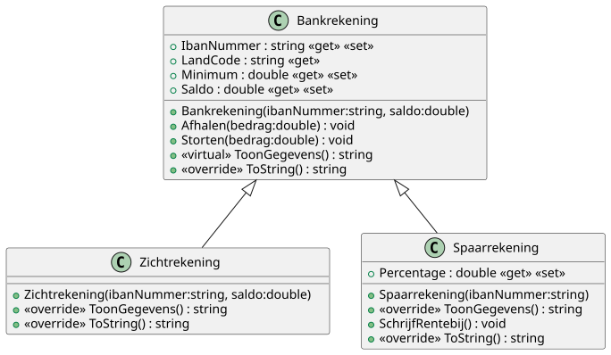
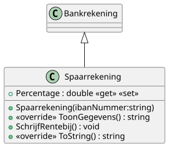

# 05_01

Deze oefening is een uitbreiding op oefening 04.02

## Klassen



### Bankrekening


**Methode `ToString()`**

Geeft de tekstuele voorstelling van het object als volgt
<IbanNummer> -> Je huidig saldo bedraagt: <Saldo> euro.

### Spaarrekening



**Constructor**

Het percentage krijgt eens standaardwaarde van 15

**Methode `ToString()`**

Geeft de tekstuele voorstelling van het object als volgt <IbanNummer> -> Je huidig saldo bedraagt: <Saldo> euro.
De rentevoet bedraagt: <Percentage>%.

### Zichtrekening


**Methode `ToString()`**

Geeft de tekstuele voorstelling van het object als volgt
<IbanNummer> -> Je hudig saldo bedraagt: <Saldo> euro.
Het minimumbedrag bedraagt: <Minimum> euro.

## Console applicatie

Bij het opstarten van de applicatie krijgt de gebruiker een menu met de volgende opties:

```
1. Spaarrekening
2. Zichtrekening
```

Afhankelijk van de keuze wordt er een respectievelijk object aangemaakt.

De gebruiker krijgt dan 4 opties:

```
1. Afhalen
2. Storten
3. Schrijf rente bij
4. Informatie
```

### Optie `Afhalen`

Vraag hoeveel de gebruiker wil afhalen. Als het bedrag kleiner of gelijk is aan 0, tonen we: "Het af te halen bedrag moet groter zijn dan 0".

Het saldo mag niet onder het minumum komen. Indien dit het geval zou zijn tonen we: "Je hebt niet genoeg saldo om deze opdracht te verwerken...".

Als bovenstaande creteria niet het geval zijn, halen we het bedrag van ons saldo.

### Optie `Storten`

Vraag hoeveel de gebruiker wil storten. Als het bedrag kleiner of gelijk is aan 0, tonen we: "Het te storten bedrag moet groter zijn dan 0". Als bovenstaande creteria niet het geval zijn, storten we het bedrag bij ons saldo.

### Optie `Schrijf rente bij`

Rente bijschrijven kan alleen als de rekening van het type Spaarrekening is.

Is dat niet het geval dan tonen we: "Deze optie is alleen beschikbaar bij een spaarrekening..."

### Optie `Informatie`

Toon een tekstuele waarde van de rekening. Gebruik hiervoor de ToString() methode.

De applicatie sluit af na deze operatie.

### Voorbeelden

```
1. Spaarrekening
2. Zichtrekening

Kies een optie: 2
1. Afhalen
2. Storten
3. Schijf rente bij
4. Informatie      

Kies een optie: 2  
Hoeveel wil je storten? 1000
1. Afhalen
2. Storten
3. Schijf rente bij
4. Informatie

Kies een optie: 1
Hoeveel wil je afhalen? 200
1. Afhalen
2. Storten
3. Schijf rente bij
4. Informatie

Kies een optie: 4
BE12 3456 7890 1234 -> Je huidig saldo bedraagt 800 euro
Het minimumbedrag bedraagt: -100 euro
```

```
1. Spaarrekening
2. Zichtrekening

Kies een optie: 1
1. Afhalen
2. Storten
3. Schijf rente bij
4. Informatie      

Kies een optie: 2  
Hoeveel wil je storten? 1000
1. Afhalen
2. Storten
3. Schijf rente bij
4. Informatie      

Kies een optie: 3  
1. Afhalen
2. Storten
3. Schijf rente bij
4. Informatie      

Kies een optie: 3  
1. Afhalen
2. Storten
3. Schijf rente bij
4. Informatie      

Kies een optie: 4  
BE12 3456 7890 1234 -> Je huidig saldo bedraagt 1322,5 euro
De rentevoet bedraagt: 15%
```

## Fuzz Test Cases

Below are the automatically generated input/output expectations.

---

### Case 1

**Complete console output:**

```
1. Spaarrekening
2. Zichtrekening

Kies een optie: 1. Afhalen
2. Storten
3. Schijf rente bij
4. Informatie

Kies een optie: Hoeveel wil je storten? 1
1. Afhalen
2. Storten
3. Schijf rente bij
4. Informatie

Kies een optie: 1. Afhalen
2. Storten
3. Schijf rente bij
4. Informatie

Kies een optie: Hoeveel wil je afhalen? 2
1. Afhalen
2. Storten
3. Schijf rente bij
4. Informatie

Kies een optie: BE12 3456 7890 1234 -> Je huidig saldo bedraagt 1227.254929700814 euro
De rentevoet bedraagt: 15%
```

**Input:**

```
1
2
1152.0475124405818
3
1
97.59970960585501
4
```

**Expected Output:**

```
1. Spaarrekening
2. Zichtrekening
Kies een optie: 1. Afhalen
2. Storten
3. Schijf rente bij
4. Informatie
Kies een optie: 1. Afhalen
2. Storten
3. Schijf rente bij
4. Informatie
Kies een optie: 1. Afhalen
2. Storten
3. Schijf rente bij
4. Informatie
Kies een optie: 1. Afhalen
2. Storten
3. Schijf rente bij
4. Informatie
Kies een optie: BE12 3456 7890 1234 -> Je huidig saldo bedraagt 1227.254929700814 euro
De rentevoet bedraagt: 15%
```

---

### Case 2

**Complete console output:**

```
1. Spaarrekening
2. Zichtrekening

Kies een optie: 1. Afhalen
2. Storten
3. Schijf rente bij
4. Informatie

Kies een optie: Hoeveel wil je storten? 2
1. Afhalen
2. Storten
3. Schijf rente bij
4. Informatie

Kies een optie: Deze optie is alleen beschikbaar bij een spaarrekening...
1. Afhalen
2. Storten
3. Schijf rente bij
4. Informatie

Kies een optie: Hoeveel wil je afhalen? 2
1. Afhalen
2. Storten
3. Schijf rente bij
4. Informatie

Kies een optie: BE12 3456 7890 1234 -> Je huidig saldo bedraagt 531.518375585034 euro
Het minimumbedrag bedraagt: -100 euro
```

**Input:**

```
2
2
625.5720950518594
3
1
94.05371946682531
4
```

**Expected Output:**

```
1. Spaarrekening
2. Zichtrekening
Kies een optie: 1. Afhalen
2. Storten
3. Schijf rente bij
4. Informatie
Kies een optie: 1. Afhalen
2. Storten
3. Schijf rente bij
4. Informatie
Kies een optie: 1. Afhalen
2. Storten
3. Schijf rente bij
4. Informatie
Kies een optie: BE12 3456 7890 1234 -> Je huidig saldo bedraagt 531.518375585034 euro
Het minimumbedrag bedraagt: -100 euro
```

---

### Case 3

**Complete console output:**

```
1. Spaarrekening
2. Zichtrekening

Kies een optie: 1. Afhalen
2. Storten
3. Schijf rente bij
4. Informatie

Kies een optie: Hoeveel wil je storten? 2
1. Afhalen
2. Storten
3. Schijf rente bij
4. Informatie

Kies een optie: Deze optie is alleen beschikbaar bij een spaarrekening...
1. Afhalen
2. Storten
3. Schijf rente bij
4. Informatie

Kies een optie: Hoeveel wil je afhalen? 2
1. Afhalen
2. Storten
3. Schijf rente bij
4. Informatie

Kies een optie: BE12 3456 7890 1234 -> Je huidig saldo bedraagt 1244.8817377187531 euro
Het minimumbedrag bedraagt: -100 euro
```

**Input:**

```
2
2
1260.060001467541
3
1
15.178263748787915
4
```

**Expected Output:**

```
1. Spaarrekening
2. Zichtrekening
Kies een optie: 1. Afhalen
2. Storten
3. Schijf rente bij
4. Informatie
Kies een optie: 1. Afhalen
2. Storten
3. Schijf rente bij
4. Informatie
Kies een optie: 1. Afhalen
2. Storten
3. Schijf rente bij
4. Informatie
Kies een optie: BE12 3456 7890 1234 -> Je huidig saldo bedraagt 1244.8817377187531 euro
Het minimumbedrag bedraagt: -100 euro
```

---

### Case 4

**Complete console output:**

```
1. Spaarrekening
2. Zichtrekening

Kies een optie: 1. Afhalen
2. Storten
3. Schijf rente bij
4. Informatie

Kies een optie: Hoeveel wil je storten? 2
1. Afhalen
2. Storten
3. Schijf rente bij
4. Informatie

Kies een optie: Deze optie is alleen beschikbaar bij een spaarrekening...
1. Afhalen
2. Storten
3. Schijf rente bij
4. Informatie

Kies een optie: Hoeveel wil je afhalen? 2
1. Afhalen
2. Storten
3. Schijf rente bij
4. Informatie

Kies een optie: BE12 3456 7890 1234 -> Je huidig saldo bedraagt 101.3616560325616 euro
Het minimumbedrag bedraagt: -100 euro
```

**Input:**

```
2
2
105.0196167200186
3
1
3.657960687457
4
```

**Expected Output:**

```
1. Spaarrekening
2. Zichtrekening
Kies een optie: 1. Afhalen
2. Storten
3. Schijf rente bij
4. Informatie
Kies een optie: 1. Afhalen
2. Storten
3. Schijf rente bij
4. Informatie
Kies een optie: 1. Afhalen
2. Storten
3. Schijf rente bij
4. Informatie
Kies een optie: BE12 3456 7890 1234 -> Je huidig saldo bedraagt 101.3616560325616 euro
Het minimumbedrag bedraagt: -100 euro
```

---

### Case 5

**Complete console output:**

```
1. Spaarrekening
2. Zichtrekening

Kies een optie: 1. Afhalen
2. Storten
3. Schijf rente bij
4. Informatie

Kies een optie: Hoeveel wil je storten? 2
1. Afhalen
2. Storten
3. Schijf rente bij
4. Informatie

Kies een optie: Deze optie is alleen beschikbaar bij een spaarrekening...
1. Afhalen
2. Storten
3. Schijf rente bij
4. Informatie

Kies een optie: Hoeveel wil je afhalen? 2
1. Afhalen
2. Storten
3. Schijf rente bij
4. Informatie

Kies een optie: BE12 3456 7890 1234 -> Je huidig saldo bedraagt 303.036616873305 euro
Het minimumbedrag bedraagt: -100 euro
```

**Input:**

```
2
2
357.92589751961015
3
1
54.889280646305174
4
```

**Expected Output:**

```
1. Spaarrekening
2. Zichtrekening
Kies een optie: 1. Afhalen
2. Storten
3. Schijf rente bij
4. Informatie
Kies een optie: 1. Afhalen
2. Storten
3. Schijf rente bij
4. Informatie
Kies een optie: 1. Afhalen
2. Storten
3. Schijf rente bij
4. Informatie
Kies een optie: BE12 3456 7890 1234 -> Je huidig saldo bedraagt 303.036616873305 euro
Het minimumbedrag bedraagt: -100 euro
```

---

### Case 6

**Complete console output:**

```
1. Spaarrekening
2. Zichtrekening

Kies een optie: 1. Afhalen
2. Storten
3. Schijf rente bij
4. Informatie

Kies een optie: Hoeveel wil je storten? 1
1. Afhalen
2. Storten
3. Schijf rente bij
4. Informatie

Kies een optie: 1. Afhalen
2. Storten
3. Schijf rente bij
4. Informatie

Kies een optie: Hoeveel wil je afhalen? 2
1. Afhalen
2. Storten
3. Schijf rente bij
4. Informatie

Kies een optie: BE12 3456 7890 1234 -> Je huidig saldo bedraagt 703.9968413648623 euro
De rentevoet bedraagt: 15%
```

**Input:**

```
1
2
613.5914339516099
3
1
1.6333076794890848
4
```

**Expected Output:**

```
1. Spaarrekening
2. Zichtrekening
Kies een optie: 1. Afhalen
2. Storten
3. Schijf rente bij
4. Informatie
Kies een optie: 1. Afhalen
2. Storten
3. Schijf rente bij
4. Informatie
Kies een optie: 1. Afhalen
2. Storten
3. Schijf rente bij
4. Informatie
Kies een optie: 1. Afhalen
2. Storten
3. Schijf rente bij
4. Informatie
Kies een optie: BE12 3456 7890 1234 -> Je huidig saldo bedraagt 703.9968413648623 euro
De rentevoet bedraagt: 15%
```

---

### Case 7

**Complete console output:**

```
1. Spaarrekening
2. Zichtrekening

Kies een optie: 1. Afhalen
2. Storten
3. Schijf rente bij
4. Informatie

Kies een optie: Hoeveel wil je storten? 2
1. Afhalen
2. Storten
3. Schijf rente bij
4. Informatie

Kies een optie: Deze optie is alleen beschikbaar bij een spaarrekening...
1. Afhalen
2. Storten
3. Schijf rente bij
4. Informatie

Kies een optie: Hoeveel wil je afhalen? 2
1. Afhalen
2. Storten
3. Schijf rente bij
4. Informatie

Kies een optie: BE12 3456 7890 1234 -> Je huidig saldo bedraagt 1002.7270939568635 euro
Het minimumbedrag bedraagt: -100 euro
```

**Input:**

```
2
2
1087.6178727365084
3
1
84.89077877964489
4
```

**Expected Output:**

```
1. Spaarrekening
2. Zichtrekening
Kies een optie: 1. Afhalen
2. Storten
3. Schijf rente bij
4. Informatie
Kies een optie: 1. Afhalen
2. Storten
3. Schijf rente bij
4. Informatie
Kies een optie: 1. Afhalen
2. Storten
3. Schijf rente bij
4. Informatie
Kies een optie: BE12 3456 7890 1234 -> Je huidig saldo bedraagt 1002.7270939568635 euro
Het minimumbedrag bedraagt: -100 euro
```

---

### Case 8

**Complete console output:**

```
1. Spaarrekening
2. Zichtrekening

Kies een optie: 1. Afhalen
2. Storten
3. Schijf rente bij
4. Informatie

Kies een optie: Hoeveel wil je storten? 1
1. Afhalen
2. Storten
3. Schijf rente bij
4. Informatie

Kies een optie: 1. Afhalen
2. Storten
3. Schijf rente bij
4. Informatie

Kies een optie: Hoeveel wil je afhalen? 2
1. Afhalen
2. Storten
3. Schijf rente bij
4. Informatie

Kies een optie: BE12 3456 7890 1234 -> Je huidig saldo bedraagt 75.37042387367553 euro
De rentevoet bedraagt: 15%
```

**Input:**

```
1
2
125.06319814883082
3
1
68.4522539974799
4
```

**Expected Output:**

```
1. Spaarrekening
2. Zichtrekening
Kies een optie: 1. Afhalen
2. Storten
3. Schijf rente bij
4. Informatie
Kies een optie: 1. Afhalen
2. Storten
3. Schijf rente bij
4. Informatie
Kies een optie: 1. Afhalen
2. Storten
3. Schijf rente bij
4. Informatie
Kies een optie: 1. Afhalen
2. Storten
3. Schijf rente bij
4. Informatie
Kies een optie: BE12 3456 7890 1234 -> Je huidig saldo bedraagt 75.37042387367553 euro
De rentevoet bedraagt: 15%
```

---

### Case 9

**Complete console output:**

```
1. Spaarrekening
2. Zichtrekening

Kies een optie: 1. Afhalen
2. Storten
3. Schijf rente bij
4. Informatie

Kies een optie: Hoeveel wil je storten? 2
1. Afhalen
2. Storten
3. Schijf rente bij
4. Informatie

Kies een optie: Deze optie is alleen beschikbaar bij een spaarrekening...
1. Afhalen
2. Storten
3. Schijf rente bij
4. Informatie

Kies een optie: Hoeveel wil je afhalen? 2
1. Afhalen
2. Storten
3. Schijf rente bij
4. Informatie

Kies een optie: BE12 3456 7890 1234 -> Je huidig saldo bedraagt 99.88266824572689 euro
Het minimumbedrag bedraagt: -100 euro
```

**Input:**

```
2
2
186.24023565235598
3
1
86.35756740662909
4
```

**Expected Output:**

```
1. Spaarrekening
2. Zichtrekening
Kies een optie: 1. Afhalen
2. Storten
3. Schijf rente bij
4. Informatie
Kies een optie: 1. Afhalen
2. Storten
3. Schijf rente bij
4. Informatie
Kies een optie: 1. Afhalen
2. Storten
3. Schijf rente bij
4. Informatie
Kies een optie: BE12 3456 7890 1234 -> Je huidig saldo bedraagt 99.88266824572689 euro
Het minimumbedrag bedraagt: -100 euro
```

---

### Case 10

**Complete console output:**

```
1. Spaarrekening
2. Zichtrekening

Kies een optie: 1. Afhalen
2. Storten
3. Schijf rente bij
4. Informatie

Kies een optie: Hoeveel wil je storten? 2
1. Afhalen
2. Storten
3. Schijf rente bij
4. Informatie

Kies een optie: Deze optie is alleen beschikbaar bij een spaarrekening...
1. Afhalen
2. Storten
3. Schijf rente bij
4. Informatie

Kies een optie: Hoeveel wil je afhalen? 2
1. Afhalen
2. Storten
3. Schijf rente bij
4. Informatie

Kies een optie: BE12 3456 7890 1234 -> Je huidig saldo bedraagt 168.5256153998576 euro
Het minimumbedrag bedraagt: -100 euro
```

**Input:**

```
2
2
204.82751659226633
3
1
36.30190119240872
4
```

**Expected Output:**

```
1. Spaarrekening
2. Zichtrekening
Kies een optie: 1. Afhalen
2. Storten
3. Schijf rente bij
4. Informatie
Kies een optie: 1. Afhalen
2. Storten
3. Schijf rente bij
4. Informatie
Kies een optie: 1. Afhalen
2. Storten
3. Schijf rente bij
4. Informatie
Kies een optie: BE12 3456 7890 1234 -> Je huidig saldo bedraagt 168.5256153998576 euro
Het minimumbedrag bedraagt: -100 euro
```

---

### Case 11

**Complete console output:**

```
1. Spaarrekening
2. Zichtrekening

Kies een optie: 1. Afhalen
2. Storten
3. Schijf rente bij
4. Informatie

Kies een optie: Hoeveel wil je storten? 2
1. Afhalen
2. Storten
3. Schijf rente bij
4. Informatie

Kies een optie: Deze optie is alleen beschikbaar bij een spaarrekening...
1. Afhalen
2. Storten
3. Schijf rente bij
4. Informatie

Kies een optie: Hoeveel wil je afhalen? 2
1. Afhalen
2. Storten
3. Schijf rente bij
4. Informatie

Kies een optie: BE12 3456 7890 1234 -> Je huidig saldo bedraagt 640.0306114018825 euro
Het minimumbedrag bedraagt: -100 euro
```

**Input:**

```
2
2
677.0880213931351
3
1
37.05740999125261
4
```

**Expected Output:**

```
1. Spaarrekening
2. Zichtrekening
Kies een optie: 1. Afhalen
2. Storten
3. Schijf rente bij
4. Informatie
Kies een optie: 1. Afhalen
2. Storten
3. Schijf rente bij
4. Informatie
Kies een optie: 1. Afhalen
2. Storten
3. Schijf rente bij
4. Informatie
Kies een optie: BE12 3456 7890 1234 -> Je huidig saldo bedraagt 640.0306114018825 euro
Het minimumbedrag bedraagt: -100 euro
```

---

### Case 12

**Complete console output:**

```
1. Spaarrekening
2. Zichtrekening

Kies een optie: 1. Afhalen
2. Storten
3. Schijf rente bij
4. Informatie

Kies een optie: Hoeveel wil je storten? 2
1. Afhalen
2. Storten
3. Schijf rente bij
4. Informatie

Kies een optie: Deze optie is alleen beschikbaar bij een spaarrekening...
1. Afhalen
2. Storten
3. Schijf rente bij
4. Informatie

Kies een optie: Hoeveel wil je afhalen? 2
1. Afhalen
2. Storten
3. Schijf rente bij
4. Informatie

Kies een optie: BE12 3456 7890 1234 -> Je huidig saldo bedraagt 866.1437127833703 euro
Het minimumbedrag bedraagt: -100 euro
```

**Input:**

```
2
2
899.4735283612391
3
1
33.329815577868764
4
```

**Expected Output:**

```
1. Spaarrekening
2. Zichtrekening
Kies een optie: 1. Afhalen
2. Storten
3. Schijf rente bij
4. Informatie
Kies een optie: 1. Afhalen
2. Storten
3. Schijf rente bij
4. Informatie
Kies een optie: 1. Afhalen
2. Storten
3. Schijf rente bij
4. Informatie
Kies een optie: BE12 3456 7890 1234 -> Je huidig saldo bedraagt 866.1437127833703 euro
Het minimumbedrag bedraagt: -100 euro
```

---

### Case 13

**Complete console output:**

```
1. Spaarrekening
2. Zichtrekening

Kies een optie: 1. Afhalen
2. Storten
3. Schijf rente bij
4. Informatie

Kies een optie: Hoeveel wil je storten? 1
1. Afhalen
2. Storten
3. Schijf rente bij
4. Informatie

Kies een optie: 1. Afhalen
2. Storten
3. Schijf rente bij
4. Informatie

Kies een optie: Hoeveel wil je afhalen? 2
1. Afhalen
2. Storten
3. Schijf rente bij
4. Informatie

Kies een optie: BE12 3456 7890 1234 -> Je huidig saldo bedraagt 838.3940833479321 euro
De rentevoet bedraagt: 15%
```

**Input:**

```
1
2
767.8163556881939
3
1
44.59472569349083
4
```

**Expected Output:**

```
1. Spaarrekening
2. Zichtrekening
Kies een optie: 1. Afhalen
2. Storten
3. Schijf rente bij
4. Informatie
Kies een optie: 1. Afhalen
2. Storten
3. Schijf rente bij
4. Informatie
Kies een optie: 1. Afhalen
2. Storten
3. Schijf rente bij
4. Informatie
Kies een optie: 1. Afhalen
2. Storten
3. Schijf rente bij
4. Informatie
Kies een optie: BE12 3456 7890 1234 -> Je huidig saldo bedraagt 838.3940833479321 euro
De rentevoet bedraagt: 15%
```

---

### Case 14

**Complete console output:**

```
1. Spaarrekening
2. Zichtrekening

Kies een optie: 1. Afhalen
2. Storten
3. Schijf rente bij
4. Informatie

Kies een optie: Hoeveel wil je storten? 2
1. Afhalen
2. Storten
3. Schijf rente bij
4. Informatie

Kies een optie: Deze optie is alleen beschikbaar bij een spaarrekening...
1. Afhalen
2. Storten
3. Schijf rente bij
4. Informatie

Kies een optie: Hoeveel wil je afhalen? 2
1. Afhalen
2. Storten
3. Schijf rente bij
4. Informatie

Kies een optie: BE12 3456 7890 1234 -> Je huidig saldo bedraagt 1058.703196051382 euro
Het minimumbedrag bedraagt: -100 euro
```

**Input:**

```
2
2
1072.9912933315509
3
1
14.288097280168712
4
```

**Expected Output:**

```
1. Spaarrekening
2. Zichtrekening
Kies een optie: 1. Afhalen
2. Storten
3. Schijf rente bij
4. Informatie
Kies een optie: 1. Afhalen
2. Storten
3. Schijf rente bij
4. Informatie
Kies een optie: 1. Afhalen
2. Storten
3. Schijf rente bij
4. Informatie
Kies een optie: BE12 3456 7890 1234 -> Je huidig saldo bedraagt 1058.703196051382 euro
Het minimumbedrag bedraagt: -100 euro
```

---

### Case 15

**Complete console output:**

```
1. Spaarrekening
2. Zichtrekening

Kies een optie: 1. Afhalen
2. Storten
3. Schijf rente bij
4. Informatie

Kies een optie: Hoeveel wil je storten? 1
1. Afhalen
2. Storten
3. Schijf rente bij
4. Informatie

Kies een optie: 1. Afhalen
2. Storten
3. Schijf rente bij
4. Informatie

Kies een optie: Hoeveel wil je afhalen? 2
1. Afhalen
2. Storten
3. Schijf rente bij
4. Informatie

Kies een optie: BE12 3456 7890 1234 -> Je huidig saldo bedraagt 65.13176954770772 euro
De rentevoet bedraagt: 15%
```

**Input:**

```
1
2
93.72318716102899
3
1
42.64989568747562
4
```

**Expected Output:**

```
1. Spaarrekening
2. Zichtrekening
Kies een optie: 1. Afhalen
2. Storten
3. Schijf rente bij
4. Informatie
Kies een optie: 1. Afhalen
2. Storten
3. Schijf rente bij
4. Informatie
Kies een optie: 1. Afhalen
2. Storten
3. Schijf rente bij
4. Informatie
Kies een optie: 1. Afhalen
2. Storten
3. Schijf rente bij
4. Informatie
Kies een optie: BE12 3456 7890 1234 -> Je huidig saldo bedraagt 65.13176954770772 euro
De rentevoet bedraagt: 15%
```

---
