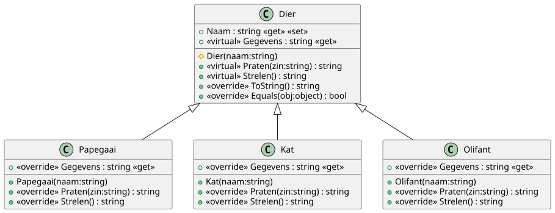
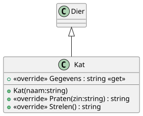
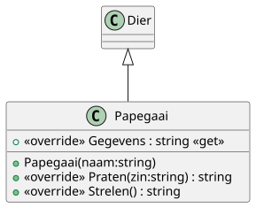
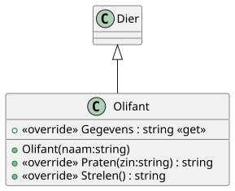

# 05_02

## Klassen



### Dier


- De gegevens van een dier worden als volgende tekstuele waarde weergegeven:
Mijn naam is `Naam` en ik ben een `klassenaam`.
- De methode ToString() geeft de gegevens van het dier weer.
- Dieren zijn hetzelfde wanneer het type en naamgeving overeenkomt.
- Wanneer een dier gestreeld wordt, zal er geen geluid gemaakt worden.
- Wanneer een dier praat, zal er geen geluid gemaakt worden. De geluiden van het strelen en praten wordt specifiek per dier bepaald.

### Kat



- De gegevens van een kat worden als volgende tekstuele waarde weergegeven:
Mijn naam is `Naam` en ik ben een `klassenaam`. Miauw! Miauw!
- Wanneer een kat gestreeld wordt, zal deze "RRR! RRRR! RRRRRRRR!" als geluid maken.
- Wanneer een kat praat, zal deze "MAAAUWWW!" als geluid maken

### Papegaai



- De gegevens van een papegaai worden als volgende tekstuele waarde weergegeven:
Mijn naam is `Naam` en ik ben een `klassenaam`. Krahh, Krahh! Wipo!
- Wanneer een papegaai gestreeld wordt, zal deze "Koko! koko! kokoooohh!" als geluid maken.
- Wanneer een papegaai praat, zal deze "Krahh! `Zin`" als geluid maken. Een papegaai herhaalt dus de zin die ingegeven wordt.

### Olifant



- De gegevens van een olifant worden als volgende tekstuele waarde weergegeven:
Mijn naam is `Naam` en ik ben een `klassenaam`. Pfwww! STOMP!
- Wanneer een olifant gestreeld wordt, zal deze "STOMP! STOMP! STOMP!" als geluid maken.
- Wanneer een olifant praat, zal deze "Pfwwwwwww!" als geluid maken.

Tip: Kopieer de geluiden om spelfouten te vermijden.

## Console applicaties

Bij het opstarten van de applicatie krijgt de gebruiker een menu met de volgende opties:

```
1. Kat
2. Olifant
3. Papegaai
```
Er wordt een naam gevraagd voor het dier. Daarna wordt er een respectievelijk object aangemaakt.

De gebruiker krijgt dan 3 opties:

```
1. Gegevens
2. Strelen
3. Praten
```
De respectievelijke acties en geluiden worden weergegeven. Indien er gekozen wordt voor 'praten', vraag je de gebruiker om nog een zin in te geven.

De applicatie sluit af na deze operatie.

## Fuzz Test Cases

Below are the automatically generated input/output expectations.

---

### Case 1

**Complete console output:**

```
Kies een optie:
1. Kat
2. Olifant
3. Papegaai
Geef een getal tussen 1 en 3: 
2
Geef een naam: 
Wipo
Kies een optie:
1. Gegevens
2. Praten
3. Strelen
Geef een getal tussen 1 en 3: 
2
Wat wil je tegen het dier zeggen? 
Dag, tot morgen.
Pfwwwwwww!
```

**Input:**

```
2
Wipo
2
Dag, tot morgen.
```

**Expected Output:**

```
Pfwwwwwww!
```

---

### Case 2

**Complete console output:**

```
Kies een optie:
1. Kat
2. Olifant
3. Papegaai
Geef een getal tussen 1 en 3: 
2
Geef een naam: 
Minoes
Kies een optie:
1. Gegevens
2. Praten
3. Strelen
Geef een getal tussen 1 en 3: 
2
Wat wil je tegen het dier zeggen? 
Dag, tot morgen.
Pfwwwwwww!
```

**Input:**

```
2
Minoes
2
Dag, tot morgen.
```

**Expected Output:**

```
Pfwwwwwww!
```

---

### Case 3

**Complete console output:**

```
Kies een optie:
1. Kat
2. Olifant
3. Papegaai
Geef een getal tussen 1 en 3: 
3
Geef een naam: 
Luna
Kies een optie:
1. Gegevens
2. Praten
3. Strelen
Geef een getal tussen 1 en 3: 
2
Wat wil je tegen het dier zeggen? 
Heb je honger?
Krahh! Heb je honger?
```

**Input:**

```
3
Luna
2
Heb je honger?
```

**Expected Output:**

```
Krahh! Heb je honger?
```

---

### Case 4

**Complete console output:**

```
Kies een optie:
1. Kat
2. Olifant
3. Papegaai
Geef een getal tussen 1 en 3: 
3
Geef een naam: 
Wipo
Kies een optie:
1. Gegevens
2. Praten
3. Strelen
Geef een getal tussen 1 en 3: 
3
Koko! koko! kokoooohh!
```

**Input:**

```
3
Wipo
3
```

**Expected Output:**

```
Koko! koko! kokoooohh!
```

---

### Case 5

**Complete console output:**

```
Kies een optie:
1. Kat
2. Olifant
3. Papegaai
Geef een getal tussen 1 en 3: 
2
Geef een naam: 
Koko
Kies een optie:
1. Gegevens
2. Praten
3. Strelen
Geef een getal tussen 1 en 3: 
2
Wat wil je tegen het dier zeggen? 
Hallo papegaai!
Pfwwwwwww!
```

**Input:**

```
2
Koko
2
Hallo papegaai!
```

**Expected Output:**

```
Pfwwwwwww!
```

---

### Case 6

**Complete console output:**

```
Kies een optie:
1. Kat
2. Olifant
3. Papegaai
Geef een getal tussen 1 en 3: 
1
Geef een naam: 
Wipo
Kies een optie:
1. Gegevens
2. Praten
3. Strelen
Geef een getal tussen 1 en 3: 
1
Mijn naam is Wipo en ik ben een Kat. Miauw! Miauw!
```

**Input:**

```
1
Wipo
1
```

**Expected Output:**

```
Mijn naam is Wipo en ik ben een Kat. Miauw! Miauw!
```

---

### Case 7

**Complete console output:**

```
Kies een optie:
1. Kat
2. Olifant
3. Papegaai
Geef een getal tussen 1 en 3: 
2
Geef een naam: 
Dumbo
Kies een optie:
1. Gegevens
2. Praten
3. Strelen
Geef een getal tussen 1 en 3: 
3
STOMP! STOMP! STOMP!
```

**Input:**

```
2
Dumbo
3
```

**Expected Output:**

```
STOMP! STOMP! STOMP!
```

---

### Case 8

**Complete console output:**

```
Kies een optie:
1. Kat
2. Olifant
3. Papegaai
Geef een getal tussen 1 en 3: 
3
Geef een naam: 
Dumbo
Kies een optie:
1. Gegevens
2. Praten
3. Strelen
Geef een getal tussen 1 en 3: 
2
Wat wil je tegen het dier zeggen? 
Hallo papegaai!
Krahh! Hallo papegaai!
```

**Input:**

```
3
Dumbo
2
Hallo papegaai!
```

**Expected Output:**

```
Krahh! Hallo papegaai!
```

---

### Case 9

**Complete console output:**

```
Kies een optie:
1. Kat
2. Olifant
3. Papegaai
Geef een getal tussen 1 en 3: 
2
Geef een naam: 
Wipo
Kies een optie:
1. Gegevens
2. Praten
3. Strelen
Geef een getal tussen 1 en 3: 
3
STOMP! STOMP! STOMP!
```

**Input:**

```
2
Wipo
3
```

**Expected Output:**

```
STOMP! STOMP! STOMP!
```

---

### Case 10

**Complete console output:**

```
Kies een optie:
1. Kat
2. Olifant
3. Papegaai
Geef een getal tussen 1 en 3: 
1
Geef een naam: 
Koko
Kies een optie:
1. Gegevens
2. Praten
3. Strelen
Geef een getal tussen 1 en 3: 
1
Mijn naam is Koko en ik ben een Kat. Miauw! Miauw!
```

**Input:**

```
1
Koko
1
```

**Expected Output:**

```
Mijn naam is Koko en ik ben een Kat. Miauw! Miauw!
```

---

### Case 11

**Complete console output:**

```
Kies een optie:
1. Kat
2. Olifant
3. Papegaai
Geef een getal tussen 1 en 3: 
1
Geef een naam: 
Koko
Kies een optie:
1. Gegevens
2. Praten
3. Strelen
Geef een getal tussen 1 en 3: 
3
RRR! RRRR! RRRRRRRR!
```

**Input:**

```
1
Koko
3
```

**Expected Output:**

```
RRR! RRRR! RRRRRRRR!
```

---

### Case 12

**Complete console output:**

```
Kies een optie:
1. Kat
2. Olifant
3. Papegaai
Geef een getal tussen 1 en 3: 
3
Geef een naam: 
Minoes
Kies een optie:
1. Gegevens
2. Praten
3. Strelen
Geef een getal tussen 1 en 3: 
1
Mijn naam is Minoes en ik ben een Papegaai. Krahh, Krahh! Wipo!
```

**Input:**

```
3
Minoes
1
```

**Expected Output:**

```
Mijn naam is Minoes en ik ben een Papegaai. Krahh, Krahh! Wipo!
```

---

### Case 13

**Complete console output:**

```
Kies een optie:
1. Kat
2. Olifant
3. Papegaai
Geef een getal tussen 1 en 3: 
3
Geef een naam: 
Koko
Kies een optie:
1. Gegevens
2. Praten
3. Strelen
Geef een getal tussen 1 en 3: 
2
Wat wil je tegen het dier zeggen? 
Hallo papegaai!
Krahh! Hallo papegaai!
```

**Input:**

```
3
Koko
2
Hallo papegaai!
```

**Expected Output:**

```
Krahh! Hallo papegaai!
```

---

### Case 14

**Complete console output:**

```
Kies een optie:
1. Kat
2. Olifant
3. Papegaai
Geef een getal tussen 1 en 3: 
1
Geef een naam: 
Koko
Kies een optie:
1. Gegevens
2. Praten
3. Strelen
Geef een getal tussen 1 en 3: 
2
Wat wil je tegen het dier zeggen? 
123
MAAAUWWW!
```

**Input:**

```
1
Koko
2
123
```

**Expected Output:**

```
MAAAUWWW!
```

---

### Case 15

**Complete console output:**

```
Kies een optie:
1. Kat
2. Olifant
3. Papegaai
Geef een getal tussen 1 en 3: 
3
Geef een naam: 
Koko
Kies een optie:
1. Gegevens
2. Praten
3. Strelen
Geef een getal tussen 1 en 3: 
1
Mijn naam is Koko en ik ben een Papegaai. Krahh, Krahh! Wipo!
```

**Input:**

```
3
Koko
1
```

**Expected Output:**

```
Mijn naam is Koko en ik ben een Papegaai. Krahh, Krahh! Wipo!
```

---
