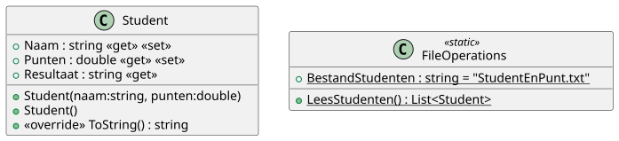

# 06_00




## Klasse

**Property `Naam`**
Deze property bevat de naam van de student die je uit het bestand haalt.

**Property `Punten`**
Deze property bevat het punt van de student die je uit het bestand haalt.

**Property `Resultaat`**
Deze property heeft enkel een getter en controleert of het punt kleiner of groter is dan 50. Als het punt kleiner is dan 50 krijgt de gebruiker "Niet geslaagd!" te zien. Als het punt groter dan of gelijk is aan 50, krijgt de gebruiker "Geslaagd!" te zien.

**Methode `ToString()`**
Deze methode print alle properties af. De output van deze methode is <Naam> <Score> <Resultaat>

## Console applicatie
Bij het opstarten van de applicatie krijgt de gebruiker een menu met de volgende opties:

```
Wat wil je doen?
----------------
1. Resultaat afdrukken
2. Afsluiten
```

Bij het ingeven van 1 krijgt de gebruiker een lijst te zien met de naam van de student, de score en of de student geslaagd is of niet. Het bestand wordt ingelezen via de methode ReadFile(string filename). Voorzie ook een methode die de keuze van de gebruiker gaat verwerken. Deze methode noem je ReadChoice(int choice) en gaat de lijst afdrukken of de applicatie afsluiten. Een regel ziet er als volgt uit: <Naam> <Score> <Resultaat>

```
StudentenEnPunt.txt
------

Mieke Vreys;89
Jef Ooms;78
Marie Leysen;56
Kristof Gheys;47
Greet Heyns;95
Sofie Leyns;75
Dirk Vanhemel;64
Jan Pittevils;51
Herman Brems;34
```

## Fuzz Test Cases

Below are the automatically generated input/output expectations.

---

### Case 1

**Complete console output:**

```
Kies een optie:
1. Resultaten afdrukken
2. Afsluiten
Maak een keuze: 2
Bedankt en tot ziens!
```

**Input:**

```
2
```

**Expected Output:**

```
Bedankt en tot ziens!
```

---

### Case 2

**Complete console output:**

```
Kies een optie:
1. Resultaten afdrukken
2. Afsluiten
Maak een keuze: 2
Bedankt en tot ziens!
```

**Input:**

```
2
```

**Expected Output:**

```
Bedankt en tot ziens!
```

---

### Case 3

**Complete console output:**

```
Kies een optie:
1. Resultaten afdrukken
2. Afsluiten
Maak een keuze: 
1
Mieke Vreys	89.00	Geslaagd!
Jef Ooms	78.00	Geslaagd!
Marie Leysen	56.00	Geslaagd!
Kristof Gheys	47.00	Niet geslaagd!
Greet Heyns	95.00	Geslaagd!
Sofie Leyns	75.00	Geslaagd!
Dirk Vanhemel	64.00	Geslaagd!
Jan Pittevils	51.00	Geslaagd!
Herman Brems	34.00	Niet geslaagd!
Bedankt en tot ziens!
```

**Input:**

```
1
```

**Expected Output:**

```
Mieke Vreys	89.00	Geslaagd!
Jef Ooms	78.00	Geslaagd!
Marie Leysen	56.00	Geslaagd!
Kristof Gheys	47.00	Niet geslaagd!
Greet Heyns	95.00	Geslaagd!
Sofie Leyns	75.00	Geslaagd!
Dirk Vanhemel	64.00	Geslaagd!
Jan Pittevils	51.00	Geslaagd!
Herman Brems	34.00	Niet geslaagd!
Bedankt en tot ziens!
```

---

### Case 4

**Complete console output:**

```
Kies een optie:
1. Resultaten afdrukken
2. Afsluiten
Maak een keuze: 2
Bedankt en tot ziens!
```

**Input:**

```
2
```

**Expected Output:**

```
Bedankt en tot ziens!
```

---

### Case 5

**Complete console output:**

```
Kies een optie:
1. Resultaten afdrukken
2. Afsluiten
Maak een keuze: 
1
Mieke Vreys	89.00	Geslaagd!
Jef Ooms	78.00	Geslaagd!
Marie Leysen	56.00	Geslaagd!
Kristof Gheys	47.00	Niet geslaagd!
Greet Heyns	95.00	Geslaagd!
Sofie Leyns	75.00	Geslaagd!
Dirk Vanhemel	64.00	Geslaagd!
Jan Pittevils	51.00	Geslaagd!
Herman Brems	34.00	Niet geslaagd!
Bedankt en tot ziens!
```

**Input:**

```
1
```

**Expected Output:**

```
Mieke Vreys	89.00	Geslaagd!
Jef Ooms	78.00	Geslaagd!
Marie Leysen	56.00	Geslaagd!
Kristof Gheys	47.00	Niet geslaagd!
Greet Heyns	95.00	Geslaagd!
Sofie Leyns	75.00	Geslaagd!
Dirk Vanhemel	64.00	Geslaagd!
Jan Pittevils	51.00	Geslaagd!
Herman Brems	34.00	Niet geslaagd!
Bedankt en tot ziens!
```

---

### Case 6

**Complete console output:**

```
Kies een optie:
1. Resultaten afdrukken
2. Afsluiten
Maak een keuze: 2
Bedankt en tot ziens!
```

**Input:**

```
2
```

**Expected Output:**

```
Bedankt en tot ziens!
```

---

### Case 7

**Complete console output:**

```
Kies een optie:
1. Resultaten afdrukken
2. Afsluiten
Maak een keuze: 2
Bedankt en tot ziens!
```

**Input:**

```
2
```

**Expected Output:**

```
Bedankt en tot ziens!
```

---

### Case 8

**Complete console output:**

```
Kies een optie:
1. Resultaten afdrukken
2. Afsluiten
Maak een keuze: 2
Bedankt en tot ziens!
```

**Input:**

```
2
```

**Expected Output:**

```
Bedankt en tot ziens!
```

---

### Case 9

**Complete console output:**

```
Kies een optie:
1. Resultaten afdrukken
2. Afsluiten
Maak een keuze: 2
Bedankt en tot ziens!
```

**Input:**

```
2
```

**Expected Output:**

```
Bedankt en tot ziens!
```

---

### Case 10

**Complete console output:**

```
Kies een optie:
1. Resultaten afdrukken
2. Afsluiten
Maak een keuze: 
1
Mieke Vreys	89.00	Geslaagd!
Jef Ooms	78.00	Geslaagd!
Marie Leysen	56.00	Geslaagd!
Kristof Gheys	47.00	Niet geslaagd!
Greet Heyns	95.00	Geslaagd!
Sofie Leyns	75.00	Geslaagd!
Dirk Vanhemel	64.00	Geslaagd!
Jan Pittevils	51.00	Geslaagd!
Herman Brems	34.00	Niet geslaagd!
Bedankt en tot ziens!
```

**Input:**

```
1
```

**Expected Output:**

```
Mieke Vreys	89.00	Geslaagd!
Jef Ooms	78.00	Geslaagd!
Marie Leysen	56.00	Geslaagd!
Kristof Gheys	47.00	Niet geslaagd!
Greet Heyns	95.00	Geslaagd!
Sofie Leyns	75.00	Geslaagd!
Dirk Vanhemel	64.00	Geslaagd!
Jan Pittevils	51.00	Geslaagd!
Herman Brems	34.00	Niet geslaagd!
Bedankt en tot ziens!
```

---

### Case 11

**Complete console output:**

```
Kies een optie:
1. Resultaten afdrukken
2. Afsluiten
Maak een keuze: 2
Bedankt en tot ziens!
```

**Input:**

```
2
```

**Expected Output:**

```
Bedankt en tot ziens!
```

---

### Case 12

**Complete console output:**

```
Kies een optie:
1. Resultaten afdrukken
2. Afsluiten
Maak een keuze: 
1
Mieke Vreys	89.00	Geslaagd!
Jef Ooms	78.00	Geslaagd!
Marie Leysen	56.00	Geslaagd!
Kristof Gheys	47.00	Niet geslaagd!
Greet Heyns	95.00	Geslaagd!
Sofie Leyns	75.00	Geslaagd!
Dirk Vanhemel	64.00	Geslaagd!
Jan Pittevils	51.00	Geslaagd!
Herman Brems	34.00	Niet geslaagd!
Bedankt en tot ziens!
```

**Input:**

```
1
```

**Expected Output:**

```
Mieke Vreys	89.00	Geslaagd!
Jef Ooms	78.00	Geslaagd!
Marie Leysen	56.00	Geslaagd!
Kristof Gheys	47.00	Niet geslaagd!
Greet Heyns	95.00	Geslaagd!
Sofie Leyns	75.00	Geslaagd!
Dirk Vanhemel	64.00	Geslaagd!
Jan Pittevils	51.00	Geslaagd!
Herman Brems	34.00	Niet geslaagd!
Bedankt en tot ziens!
```

---

### Case 13

**Complete console output:**

```
Kies een optie:
1. Resultaten afdrukken
2. Afsluiten
Maak een keuze: 
1
Mieke Vreys	89.00	Geslaagd!
Jef Ooms	78.00	Geslaagd!
Marie Leysen	56.00	Geslaagd!
Kristof Gheys	47.00	Niet geslaagd!
Greet Heyns	95.00	Geslaagd!
Sofie Leyns	75.00	Geslaagd!
Dirk Vanhemel	64.00	Geslaagd!
Jan Pittevils	51.00	Geslaagd!
Herman Brems	34.00	Niet geslaagd!
Bedankt en tot ziens!
```

**Input:**

```
1
```

**Expected Output:**

```
Mieke Vreys	89.00	Geslaagd!
Jef Ooms	78.00	Geslaagd!
Marie Leysen	56.00	Geslaagd!
Kristof Gheys	47.00	Niet geslaagd!
Greet Heyns	95.00	Geslaagd!
Sofie Leyns	75.00	Geslaagd!
Dirk Vanhemel	64.00	Geslaagd!
Jan Pittevils	51.00	Geslaagd!
Herman Brems	34.00	Niet geslaagd!
Bedankt en tot ziens!
```

---

### Case 14

**Complete console output:**

```
Kies een optie:
1. Resultaten afdrukken
2. Afsluiten
Maak een keuze: 2
Bedankt en tot ziens!
```

**Input:**

```
2
```

**Expected Output:**

```
Bedankt en tot ziens!
```

---

### Case 15

**Complete console output:**

```
Kies een optie:
1. Resultaten afdrukken
2. Afsluiten
Maak een keuze: 
1
Mieke Vreys	89.00	Geslaagd!
Jef Ooms	78.00	Geslaagd!
Marie Leysen	56.00	Geslaagd!
Kristof Gheys	47.00	Niet geslaagd!
Greet Heyns	95.00	Geslaagd!
Sofie Leyns	75.00	Geslaagd!
Dirk Vanhemel	64.00	Geslaagd!
Jan Pittevils	51.00	Geslaagd!
Herman Brems	34.00	Niet geslaagd!
Bedankt en tot ziens!
```

**Input:**

```
1
```

**Expected Output:**

```
Mieke Vreys	89.00	Geslaagd!
Jef Ooms	78.00	Geslaagd!
Marie Leysen	56.00	Geslaagd!
Kristof Gheys	47.00	Niet geslaagd!
Greet Heyns	95.00	Geslaagd!
Sofie Leyns	75.00	Geslaagd!
Dirk Vanhemel	64.00	Geslaagd!
Jan Pittevils	51.00	Geslaagd!
Herman Brems	34.00	Niet geslaagd!
Bedankt en tot ziens!
```

---
