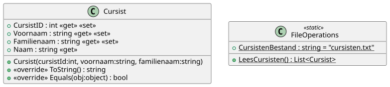

# 06_02

## Klassen



## Console applicatie

Bij het opstarten van de applicatie worden de cursisten uit het bestand `cursisten.txt` getoond. De applicatie toont daarna de opties 'Toevoegen' en 'Verwijderen'. De meegeleverde lijst bevat:

```plaintext
Cursisten
---------

1. Hans Vandamme
2. Julia Wouters
3. Wannes Claes
4. Marlies Feys
5. Mike Van Campfort
6. Marie Deckers
7. Ruben Holvoet
8. Katrien Verhaeghe
9. Jens Van Daele
10. Emily De Smet
11. Peter Faes
12. Nona Demets

Wat wil je doen?

0. Toevoegen
1. Verwijderen

Maak een keuze:
```

Bij een ongeldige keuze wordt opnieuw om een keuze gevraagd. Als de gebruiker kiest voor 'Toevoegen' (keuze `0`), wordt om de voornaam en familienaam gevraagd:

```plaintext
Geef de voornaam van de nieuwe cursist:
Matthias
Geef de familienaam van de nieuwe cursist:
Claessen
```

Daarna krijgt de gebruiker de bijgewerkte lijst te zien. De nieuwe cursist krijgt het volgende ID:

```plaintext
Nieuwe lijst van cursisten
--------------------------

1. Hans Vandamme
2. Julia Wouters
3. Wannes Claes
4. Marlies Feys
5. Mike Van Campfort
6. Marie Deckers
7. Ruben Holvoet
8. Katrien Verhaeghe
9. Jens Van Daele
10. Emily De Smet
11. Peter Faes
12. Nona Demets
13. Matthias Claessen

Druk op Enter om verder te gaan.
```

Als de gebruiker kiest voor 'Verwijderen' (keuze `1`), wordt eerst de huidige lijst getoond. Daarna vraagt de applicatie om het ID van de cursist die verwijderd moet worden:

```plaintext
Geef de cursistId in van de cursist die je wil verwijderen:
```

Na het verwijderen worden de ID's van de overblijvende cursisten bijgewerkt. Bijvoorbeeld: als de gebruiker `2` ingeeft, wordt Julia Wouters verwijderd en krijgt Wannes Claes ID `2`.

```plaintext
Nieuwe lijst van cursisten
--------------------------

1. Hans Vandamme
2. Wannes Claes
3. Marlies Feys
4. Mike Van Campfort
5. Marie Deckers
6. Ruben Holvoet
7. Katrien Verhaeghe
8. Jens Van Daele
9. Emily De Smet
10. Peter Faes
11. Nona Demets

Druk op Enter om verder te gaan.
```

De applicatie controleert bij het verwijderen of het ingegeven ID een getal is en binnen het toegelaten bereik valt. Na toevoegen of verwijderen toont de applicatie de bijgewerkte lijst en de melding 'Druk op Enter om verder te gaan.'.

Voorzie in je Program.cs ook de volgende methodes:

**Methode `PrintOptions`**

Deze methode toont de 2 opties aan de gebruiker, namelijk 'Toevoegen' en 'Verwijderen'. Deze methode geeft een int terug met daarin de keuze die de gebruiker gemaakt heeft (0 of 1). Voorzie hier ook dat er gecontroleerd wordt of er effectief een getal ingegeven wordt.

**Methode `PrintCursisten`**

Deze methode print alle cursisten af. Aangezien we dit meerdere keren doen in onze applicatie, is het handig om deze code in een methode te steken.

## Fuzz Test Cases

Below are the automatically generated input/output expectations.

---

### Case 1

**Complete console output:**

```
1. Hans Vandamme
2. Julia Wouters
3. Wannes Claes
4. Marlies Feys
5. Mike Van Campfort
6. Marie Deckers
7. Ruben Holvoet
8. Katrien Verhaeghe
9. Jens Van Daele
10. Emily De Smet
11. Peter Faes
12. Nona Demets
Kies een optie:
1. Toevoegen
2. Verwijderen
1
Geef de voornaam van de nieuwe cursist: 
Christina
Geef de familienaam van de nieuwe cursist: 
Belmans
1. Hans Vandamme
2. Julia Wouters
3. Wannes Claes
4. Marlies Feys
5. Mike Van Campfort
6. Marie Deckers
7. Ruben Holvoet
8. Katrien Verhaeghe
9. Jens Van Daele
10. Emily De Smet
11. Peter Faes
12. Nona Demets
13. Christina Belmans
Bedankt en tot ziens!
```

**Input:**

```
1
Christina
Belmans
```

**Expected Output:**

```
1. Hans Vandamme
2. Julia Wouters
3. Wannes Claes
4. Marlies Feys
5. Mike Van Campfort
6. Marie Deckers
7. Ruben Holvoet
8. Katrien Verhaeghe
9. Jens Van Daele
10. Emily De Smet
11. Peter Faes
12. Nona Demets
1. Hans Vandamme
2. Julia Wouters
3. Wannes Claes
4. Marlies Feys
5. Mike Van Campfort
6. Marie Deckers
7. Ruben Holvoet
8. Katrien Verhaeghe
9. Jens Van Daele
10. Emily De Smet
11. Peter Faes
12. Nona Demets
13. Christina Belmans
Bedankt en tot ziens!
```

---

### Case 2

**Complete console output:**

```
1. Hans Vandamme
2. Julia Wouters
3. Wannes Claes
4. Marlies Feys
5. Mike Van Campfort
6. Marie Deckers
7. Ruben Holvoet
8. Katrien Verhaeghe
9. Jens Van Daele
10. Emily De Smet
11. Peter Faes
12. Nona Demets
Kies een optie:
1. Toevoegen
2. Verwijderen
1
Geef de voornaam van de nieuwe cursist: 
Christine
Geef de familienaam van de nieuwe cursist: 
Neirynck
1. Hans Vandamme
2. Julia Wouters
3. Wannes Claes
4. Marlies Feys
5. Mike Van Campfort
6. Marie Deckers
7. Ruben Holvoet
8. Katrien Verhaeghe
9. Jens Van Daele
10. Emily De Smet
11. Peter Faes
12. Nona Demets
13. Christine Neirynck
Bedankt en tot ziens!
```

**Input:**

```
1
Christine
Neirynck
```

**Expected Output:**

```
1. Hans Vandamme
2. Julia Wouters
3. Wannes Claes
4. Marlies Feys
5. Mike Van Campfort
6. Marie Deckers
7. Ruben Holvoet
8. Katrien Verhaeghe
9. Jens Van Daele
10. Emily De Smet
11. Peter Faes
12. Nona Demets
1. Hans Vandamme
2. Julia Wouters
3. Wannes Claes
4. Marlies Feys
5. Mike Van Campfort
6. Marie Deckers
7. Ruben Holvoet
8. Katrien Verhaeghe
9. Jens Van Daele
10. Emily De Smet
11. Peter Faes
12. Nona Demets
13. Christine Neirynck
Bedankt en tot ziens!
```

---

### Case 3

**Complete console output:**

```
1. Hans Vandamme
2. Julia Wouters
3. Wannes Claes
4. Marlies Feys
5. Mike Van Campfort
6. Marie Deckers
7. Ruben Holvoet
8. Katrien Verhaeghe
9. Jens Van Daele
10. Emily De Smet
11. Peter Faes
12. Nona Demets
Kies een optie:
1. Toevoegen
2. Verwijderen
1
Geef de voornaam van de nieuwe cursist: 
Jonas
Geef de familienaam van de nieuwe cursist: 
Thomas
1. Hans Vandamme
2. Julia Wouters
3. Wannes Claes
4. Marlies Feys
5. Mike Van Campfort
6. Marie Deckers
7. Ruben Holvoet
8. Katrien Verhaeghe
9. Jens Van Daele
10. Emily De Smet
11. Peter Faes
12. Nona Demets
13. Jonas Thomas
Bedankt en tot ziens!
```

**Input:**

```
1
Jonas
Thomas
```

**Expected Output:**

```
1. Hans Vandamme
2. Julia Wouters
3. Wannes Claes
4. Marlies Feys
5. Mike Van Campfort
6. Marie Deckers
7. Ruben Holvoet
8. Katrien Verhaeghe
9. Jens Van Daele
10. Emily De Smet
11. Peter Faes
12. Nona Demets
1. Hans Vandamme
2. Julia Wouters
3. Wannes Claes
4. Marlies Feys
5. Mike Van Campfort
6. Marie Deckers
7. Ruben Holvoet
8. Katrien Verhaeghe
9. Jens Van Daele
10. Emily De Smet
11. Peter Faes
12. Nona Demets
13. Jonas Thomas
Bedankt en tot ziens!
```

---

### Case 4

**Complete console output:**

```
1. Hans Vandamme
2. Julia Wouters
3. Wannes Claes
4. Marlies Feys
5. Mike Van Campfort
6. Marie Deckers
7. Ruben Holvoet
8. Katrien Verhaeghe
9. Jens Van Daele
10. Emily De Smet
11. Peter Faes
12. Nona Demets
Kies een optie:
1. Toevoegen
2. Verwijderen
2
1. Hans Vandamme
2. Julia Wouters
3. Wannes Claes
4. Marlies Feys
5. Mike Van Campfort
6. Marie Deckers
7. Ruben Holvoet
8. Katrien Verhaeghe
9. Jens Van Daele
10. Emily De Smet
11. Peter Faes
12. Nona Demets
Geef de cursistId in van de cursist die je wil verwijderen: 
5
1. Hans Vandamme
2. Julia Wouters
3. Wannes Claes
4. Marlies Feys
5. Marie Deckers
6. Ruben Holvoet
7. Katrien Verhaeghe
8. Jens Van Daele
9. Emily De Smet
10. Peter Faes
11. Nona Demets
Bedankt en tot ziens!
```

**Input:**

```
2
5
```

**Expected Output:**

```
1. Hans Vandamme
2. Julia Wouters
3. Wannes Claes
4. Marlies Feys
5. Mike Van Campfort
6. Marie Deckers
7. Ruben Holvoet
8. Katrien Verhaeghe
9. Jens Van Daele
10. Emily De Smet
11. Peter Faes
12. Nona Demets
1. Hans Vandamme
2. Julia Wouters
3. Wannes Claes
4. Marlies Feys
5. Mike Van Campfort
6. Marie Deckers
7. Ruben Holvoet
8. Katrien Verhaeghe
9. Jens Van Daele
10. Emily De Smet
11. Peter Faes
12. Nona Demets
1. Hans Vandamme
2. Julia Wouters
3. Wannes Claes
4. Marlies Feys
5. Marie Deckers
6. Ruben Holvoet
7. Katrien Verhaeghe
8. Jens Van Daele
9. Emily De Smet
10. Peter Faes
11. Nona Demets
Bedankt en tot ziens!
```

---

### Case 5

**Complete console output:**

```
1. Hans Vandamme
2. Julia Wouters
3. Wannes Claes
4. Marlies Feys
5. Mike Van Campfort
6. Marie Deckers
7. Ruben Holvoet
8. Katrien Verhaeghe
9. Jens Van Daele
10. Emily De Smet
11. Peter Faes
12. Nona Demets
Kies een optie:
1. Toevoegen
2. Verwijderen
1
Geef de voornaam van de nieuwe cursist: 
Tim
Geef de familienaam van de nieuwe cursist: 
Smolders
1. Hans Vandamme
2. Julia Wouters
3. Wannes Claes
4. Marlies Feys
5. Mike Van Campfort
6. Marie Deckers
7. Ruben Holvoet
8. Katrien Verhaeghe
9. Jens Van Daele
10. Emily De Smet
11. Peter Faes
12. Nona Demets
13. Tim Smolders
Bedankt en tot ziens!
```

**Input:**

```
1
Tim
Smolders
```

**Expected Output:**

```
1. Hans Vandamme
2. Julia Wouters
3. Wannes Claes
4. Marlies Feys
5. Mike Van Campfort
6. Marie Deckers
7. Ruben Holvoet
8. Katrien Verhaeghe
9. Jens Van Daele
10. Emily De Smet
11. Peter Faes
12. Nona Demets
1. Hans Vandamme
2. Julia Wouters
3. Wannes Claes
4. Marlies Feys
5. Mike Van Campfort
6. Marie Deckers
7. Ruben Holvoet
8. Katrien Verhaeghe
9. Jens Van Daele
10. Emily De Smet
11. Peter Faes
12. Nona Demets
13. Tim Smolders
Bedankt en tot ziens!
```

---

### Case 6

**Complete console output:**

```
1. Hans Vandamme
2. Julia Wouters
3. Wannes Claes
4. Marlies Feys
5. Mike Van Campfort
6. Marie Deckers
7. Ruben Holvoet
8. Katrien Verhaeghe
9. Jens Van Daele
10. Emily De Smet
11. Peter Faes
12. Nona Demets
Kies een optie:
1. Toevoegen
2. Verwijderen
2
1. Hans Vandamme
2. Julia Wouters
3. Wannes Claes
4. Marlies Feys
5. Mike Van Campfort
6. Marie Deckers
7. Ruben Holvoet
8. Katrien Verhaeghe
9. Jens Van Daele
10. Emily De Smet
11. Peter Faes
12. Nona Demets
Geef de cursistId in van de cursist die je wil verwijderen: 
5
1. Hans Vandamme
2. Julia Wouters
3. Wannes Claes
4. Marlies Feys
5. Marie Deckers
6. Ruben Holvoet
7. Katrien Verhaeghe
8. Jens Van Daele
9. Emily De Smet
10. Peter Faes
11. Nona Demets
Bedankt en tot ziens!
```

**Input:**

```
2
5
```

**Expected Output:**

```
1. Hans Vandamme
2. Julia Wouters
3. Wannes Claes
4. Marlies Feys
5. Mike Van Campfort
6. Marie Deckers
7. Ruben Holvoet
8. Katrien Verhaeghe
9. Jens Van Daele
10. Emily De Smet
11. Peter Faes
12. Nona Demets
1. Hans Vandamme
2. Julia Wouters
3. Wannes Claes
4. Marlies Feys
5. Mike Van Campfort
6. Marie Deckers
7. Ruben Holvoet
8. Katrien Verhaeghe
9. Jens Van Daele
10. Emily De Smet
11. Peter Faes
12. Nona Demets
1. Hans Vandamme
2. Julia Wouters
3. Wannes Claes
4. Marlies Feys
5. Marie Deckers
6. Ruben Holvoet
7. Katrien Verhaeghe
8. Jens Van Daele
9. Emily De Smet
10. Peter Faes
11. Nona Demets
Bedankt en tot ziens!
```

---

### Case 7

**Complete console output:**

```
1. Hans Vandamme
2. Julia Wouters
3. Wannes Claes
4. Marlies Feys
5. Mike Van Campfort
6. Marie Deckers
7. Ruben Holvoet
8. Katrien Verhaeghe
9. Jens Van Daele
10. Emily De Smet
11. Peter Faes
12. Nona Demets
Kies een optie:
1. Toevoegen
2. Verwijderen
2
1. Hans Vandamme
2. Julia Wouters
3. Wannes Claes
4. Marlies Feys
5. Mike Van Campfort
6. Marie Deckers
7. Ruben Holvoet
8. Katrien Verhaeghe
9. Jens Van Daele
10. Emily De Smet
11. Peter Faes
12. Nona Demets
Geef de cursistId in van de cursist die je wil verwijderen: 
5
1. Hans Vandamme
2. Julia Wouters
3. Wannes Claes
4. Marlies Feys
5. Marie Deckers
6. Ruben Holvoet
7. Katrien Verhaeghe
8. Jens Van Daele
9. Emily De Smet
10. Peter Faes
11. Nona Demets
Bedankt en tot ziens!
```

**Input:**

```
2
5
```

**Expected Output:**

```
1. Hans Vandamme
2. Julia Wouters
3. Wannes Claes
4. Marlies Feys
5. Mike Van Campfort
6. Marie Deckers
7. Ruben Holvoet
8. Katrien Verhaeghe
9. Jens Van Daele
10. Emily De Smet
11. Peter Faes
12. Nona Demets
1. Hans Vandamme
2. Julia Wouters
3. Wannes Claes
4. Marlies Feys
5. Mike Van Campfort
6. Marie Deckers
7. Ruben Holvoet
8. Katrien Verhaeghe
9. Jens Van Daele
10. Emily De Smet
11. Peter Faes
12. Nona Demets
1. Hans Vandamme
2. Julia Wouters
3. Wannes Claes
4. Marlies Feys
5. Marie Deckers
6. Ruben Holvoet
7. Katrien Verhaeghe
8. Jens Van Daele
9. Emily De Smet
10. Peter Faes
11. Nona Demets
Bedankt en tot ziens!
```

---

### Case 8

**Complete console output:**

```
1. Hans Vandamme
2. Julia Wouters
3. Wannes Claes
4. Marlies Feys
5. Mike Van Campfort
6. Marie Deckers
7. Ruben Holvoet
8. Katrien Verhaeghe
9. Jens Van Daele
10. Emily De Smet
11. Peter Faes
12. Nona Demets
Kies een optie:
1. Toevoegen
2. Verwijderen
1
Geef de voornaam van de nieuwe cursist: 
Jozef
Geef de familienaam van de nieuwe cursist: 
Stevens
1. Hans Vandamme
2. Julia Wouters
3. Wannes Claes
4. Marlies Feys
5. Mike Van Campfort
6. Marie Deckers
7. Ruben Holvoet
8. Katrien Verhaeghe
9. Jens Van Daele
10. Emily De Smet
11. Peter Faes
12. Nona Demets
13. Jozef Stevens
Bedankt en tot ziens!
```

**Input:**

```
1
Jozef
Stevens
```

**Expected Output:**

```
1. Hans Vandamme
2. Julia Wouters
3. Wannes Claes
4. Marlies Feys
5. Mike Van Campfort
6. Marie Deckers
7. Ruben Holvoet
8. Katrien Verhaeghe
9. Jens Van Daele
10. Emily De Smet
11. Peter Faes
12. Nona Demets
1. Hans Vandamme
2. Julia Wouters
3. Wannes Claes
4. Marlies Feys
5. Mike Van Campfort
6. Marie Deckers
7. Ruben Holvoet
8. Katrien Verhaeghe
9. Jens Van Daele
10. Emily De Smet
11. Peter Faes
12. Nona Demets
13. Jozef Stevens
Bedankt en tot ziens!
```

---

### Case 9

**Complete console output:**

```
1. Hans Vandamme
2. Julia Wouters
3. Wannes Claes
4. Marlies Feys
5. Mike Van Campfort
6. Marie Deckers
7. Ruben Holvoet
8. Katrien Verhaeghe
9. Jens Van Daele
10. Emily De Smet
11. Peter Faes
12. Nona Demets
Kies een optie:
1. Toevoegen
2. Verwijderen
2
1. Hans Vandamme
2. Julia Wouters
3. Wannes Claes
4. Marlies Feys
5. Mike Van Campfort
6. Marie Deckers
7. Ruben Holvoet
8. Katrien Verhaeghe
9. Jens Van Daele
10. Emily De Smet
11. Peter Faes
12. Nona Demets
Geef de cursistId in van de cursist die je wil verwijderen: 
1
1. Julia Wouters
2. Wannes Claes
3. Marlies Feys
4. Mike Van Campfort
5. Marie Deckers
6. Ruben Holvoet
7. Katrien Verhaeghe
8. Jens Van Daele
9. Emily De Smet
10. Peter Faes
11. Nona Demets
Bedankt en tot ziens!
```

**Input:**

```
2
1
```

**Expected Output:**

```
1. Hans Vandamme
2. Julia Wouters
3. Wannes Claes
4. Marlies Feys
5. Mike Van Campfort
6. Marie Deckers
7. Ruben Holvoet
8. Katrien Verhaeghe
9. Jens Van Daele
10. Emily De Smet
11. Peter Faes
12. Nona Demets
1. Hans Vandamme
2. Julia Wouters
3. Wannes Claes
4. Marlies Feys
5. Mike Van Campfort
6. Marie Deckers
7. Ruben Holvoet
8. Katrien Verhaeghe
9. Jens Van Daele
10. Emily De Smet
11. Peter Faes
12. Nona Demets
1. Julia Wouters
2. Wannes Claes
3. Marlies Feys
4. Mike Van Campfort
5. Marie Deckers
6. Ruben Holvoet
7. Katrien Verhaeghe
8. Jens Van Daele
9. Emily De Smet
10. Peter Faes
11. Nona Demets
Bedankt en tot ziens!
```

---

### Case 10

**Complete console output:**

```
1. Hans Vandamme
2. Julia Wouters
3. Wannes Claes
4. Marlies Feys
5. Mike Van Campfort
6. Marie Deckers
7. Ruben Holvoet
8. Katrien Verhaeghe
9. Jens Van Daele
10. Emily De Smet
11. Peter Faes
12. Nona Demets
Kies een optie:
1. Toevoegen
2. Verwijderen
2
1. Hans Vandamme
2. Julia Wouters
3. Wannes Claes
4. Marlies Feys
5. Mike Van Campfort
6. Marie Deckers
7. Ruben Holvoet
8. Katrien Verhaeghe
9. Jens Van Daele
10. Emily De Smet
11. Peter Faes
12. Nona Demets
Geef de cursistId in van de cursist die je wil verwijderen: 
2
1. Hans Vandamme
2. Wannes Claes
3. Marlies Feys
4. Mike Van Campfort
5. Marie Deckers
6. Ruben Holvoet
7. Katrien Verhaeghe
8. Jens Van Daele
9. Emily De Smet
10. Peter Faes
11. Nona Demets
Bedankt en tot ziens!
```

**Input:**

```
2
2
```

**Expected Output:**

```
1. Hans Vandamme
2. Julia Wouters
3. Wannes Claes
4. Marlies Feys
5. Mike Van Campfort
6. Marie Deckers
7. Ruben Holvoet
8. Katrien Verhaeghe
9. Jens Van Daele
10. Emily De Smet
11. Peter Faes
12. Nona Demets
1. Hans Vandamme
2. Julia Wouters
3. Wannes Claes
4. Marlies Feys
5. Mike Van Campfort
6. Marie Deckers
7. Ruben Holvoet
8. Katrien Verhaeghe
9. Jens Van Daele
10. Emily De Smet
11. Peter Faes
12. Nona Demets
1. Hans Vandamme
2. Wannes Claes
3. Marlies Feys
4. Mike Van Campfort
5. Marie Deckers
6. Ruben Holvoet
7. Katrien Verhaeghe
8. Jens Van Daele
9. Emily De Smet
10. Peter Faes
11. Nona Demets
Bedankt en tot ziens!
```

---

### Case 11

**Complete console output:**

```
1. Hans Vandamme
2. Julia Wouters
3. Wannes Claes
4. Marlies Feys
5. Mike Van Campfort
6. Marie Deckers
7. Ruben Holvoet
8. Katrien Verhaeghe
9. Jens Van Daele
10. Emily De Smet
11. Peter Faes
12. Nona Demets
Kies een optie:
1. Toevoegen
2. Verwijderen
1
Geef de voornaam van de nieuwe cursist: 
Gert
Geef de familienaam van de nieuwe cursist: 
Janssen
1. Hans Vandamme
2. Julia Wouters
3. Wannes Claes
4. Marlies Feys
5. Mike Van Campfort
6. Marie Deckers
7. Ruben Holvoet
8. Katrien Verhaeghe
9. Jens Van Daele
10. Emily De Smet
11. Peter Faes
12. Nona Demets
13. Gert Janssen
Bedankt en tot ziens!
```

**Input:**

```
1
Gert
Janssen
```

**Expected Output:**

```
1. Hans Vandamme
2. Julia Wouters
3. Wannes Claes
4. Marlies Feys
5. Mike Van Campfort
6. Marie Deckers
7. Ruben Holvoet
8. Katrien Verhaeghe
9. Jens Van Daele
10. Emily De Smet
11. Peter Faes
12. Nona Demets
1. Hans Vandamme
2. Julia Wouters
3. Wannes Claes
4. Marlies Feys
5. Mike Van Campfort
6. Marie Deckers
7. Ruben Holvoet
8. Katrien Verhaeghe
9. Jens Van Daele
10. Emily De Smet
11. Peter Faes
12. Nona Demets
13. Gert Janssen
Bedankt en tot ziens!
```

---

### Case 12

**Complete console output:**

```
1. Hans Vandamme
2. Julia Wouters
3. Wannes Claes
4. Marlies Feys
5. Mike Van Campfort
6. Marie Deckers
7. Ruben Holvoet
8. Katrien Verhaeghe
9. Jens Van Daele
10. Emily De Smet
11. Peter Faes
12. Nona Demets
Kies een optie:
1. Toevoegen
2. Verwijderen
2
1. Hans Vandamme
2. Julia Wouters
3. Wannes Claes
4. Marlies Feys
5. Mike Van Campfort
6. Marie Deckers
7. Ruben Holvoet
8. Katrien Verhaeghe
9. Jens Van Daele
10. Emily De Smet
11. Peter Faes
12. Nona Demets
Geef de cursistId in van de cursist die je wil verwijderen: 
1
1. Julia Wouters
2. Wannes Claes
3. Marlies Feys
4. Mike Van Campfort
5. Marie Deckers
6. Ruben Holvoet
7. Katrien Verhaeghe
8. Jens Van Daele
9. Emily De Smet
10. Peter Faes
11. Nona Demets
Bedankt en tot ziens!
```

**Input:**

```
2
1
```

**Expected Output:**

```
1. Hans Vandamme
2. Julia Wouters
3. Wannes Claes
4. Marlies Feys
5. Mike Van Campfort
6. Marie Deckers
7. Ruben Holvoet
8. Katrien Verhaeghe
9. Jens Van Daele
10. Emily De Smet
11. Peter Faes
12. Nona Demets
1. Hans Vandamme
2. Julia Wouters
3. Wannes Claes
4. Marlies Feys
5. Mike Van Campfort
6. Marie Deckers
7. Ruben Holvoet
8. Katrien Verhaeghe
9. Jens Van Daele
10. Emily De Smet
11. Peter Faes
12. Nona Demets
1. Julia Wouters
2. Wannes Claes
3. Marlies Feys
4. Mike Van Campfort
5. Marie Deckers
6. Ruben Holvoet
7. Katrien Verhaeghe
8. Jens Van Daele
9. Emily De Smet
10. Peter Faes
11. Nona Demets
Bedankt en tot ziens!
```

---

### Case 13

**Complete console output:**

```
1. Hans Vandamme
2. Julia Wouters
3. Wannes Claes
4. Marlies Feys
5. Mike Van Campfort
6. Marie Deckers
7. Ruben Holvoet
8. Katrien Verhaeghe
9. Jens Van Daele
10. Emily De Smet
11. Peter Faes
12. Nona Demets
Kies een optie:
1. Toevoegen
2. Verwijderen
1
Geef de voornaam van de nieuwe cursist: 
Clara
Geef de familienaam van de nieuwe cursist: 
Goovaerts
1. Hans Vandamme
2. Julia Wouters
3. Wannes Claes
4. Marlies Feys
5. Mike Van Campfort
6. Marie Deckers
7. Ruben Holvoet
8. Katrien Verhaeghe
9. Jens Van Daele
10. Emily De Smet
11. Peter Faes
12. Nona Demets
13. Clara Goovaerts
Bedankt en tot ziens!
```

**Input:**

```
1
Clara
Goovaerts
```

**Expected Output:**

```
1. Hans Vandamme
2. Julia Wouters
3. Wannes Claes
4. Marlies Feys
5. Mike Van Campfort
6. Marie Deckers
7. Ruben Holvoet
8. Katrien Verhaeghe
9. Jens Van Daele
10. Emily De Smet
11. Peter Faes
12. Nona Demets
1. Hans Vandamme
2. Julia Wouters
3. Wannes Claes
4. Marlies Feys
5. Mike Van Campfort
6. Marie Deckers
7. Ruben Holvoet
8. Katrien Verhaeghe
9. Jens Van Daele
10. Emily De Smet
11. Peter Faes
12. Nona Demets
13. Clara Goovaerts
Bedankt en tot ziens!
```

---

### Case 14

**Complete console output:**

```
1. Hans Vandamme
2. Julia Wouters
3. Wannes Claes
4. Marlies Feys
5. Mike Van Campfort
6. Marie Deckers
7. Ruben Holvoet
8. Katrien Verhaeghe
9. Jens Van Daele
10. Emily De Smet
11. Peter Faes
12. Nona Demets
Kies een optie:
1. Toevoegen
2. Verwijderen
2
1. Hans Vandamme
2. Julia Wouters
3. Wannes Claes
4. Marlies Feys
5. Mike Van Campfort
6. Marie Deckers
7. Ruben Holvoet
8. Katrien Verhaeghe
9. Jens Van Daele
10. Emily De Smet
11. Peter Faes
12. Nona Demets
Geef de cursistId in van de cursist die je wil verwijderen: 
2
1. Hans Vandamme
2. Wannes Claes
3. Marlies Feys
4. Mike Van Campfort
5. Marie Deckers
6. Ruben Holvoet
7. Katrien Verhaeghe
8. Jens Van Daele
9. Emily De Smet
10. Peter Faes
11. Nona Demets
Bedankt en tot ziens!
```

**Input:**

```
2
2
```

**Expected Output:**

```
1. Hans Vandamme
2. Julia Wouters
3. Wannes Claes
4. Marlies Feys
5. Mike Van Campfort
6. Marie Deckers
7. Ruben Holvoet
8. Katrien Verhaeghe
9. Jens Van Daele
10. Emily De Smet
11. Peter Faes
12. Nona Demets
1. Hans Vandamme
2. Julia Wouters
3. Wannes Claes
4. Marlies Feys
5. Mike Van Campfort
6. Marie Deckers
7. Ruben Holvoet
8. Katrien Verhaeghe
9. Jens Van Daele
10. Emily De Smet
11. Peter Faes
12. Nona Demets
1. Hans Vandamme
2. Wannes Claes
3. Marlies Feys
4. Mike Van Campfort
5. Marie Deckers
6. Ruben Holvoet
7. Katrien Verhaeghe
8. Jens Van Daele
9. Emily De Smet
10. Peter Faes
11. Nona Demets
Bedankt en tot ziens!
```

---

### Case 15

**Complete console output:**

```
1. Hans Vandamme
2. Julia Wouters
3. Wannes Claes
4. Marlies Feys
5. Mike Van Campfort
6. Marie Deckers
7. Ruben Holvoet
8. Katrien Verhaeghe
9. Jens Van Daele
10. Emily De Smet
11. Peter Faes
12. Nona Demets
Kies een optie:
1. Toevoegen
2. Verwijderen
2
1. Hans Vandamme
2. Julia Wouters
3. Wannes Claes
4. Marlies Feys
5. Mike Van Campfort
6. Marie Deckers
7. Ruben Holvoet
8. Katrien Verhaeghe
9. Jens Van Daele
10. Emily De Smet
11. Peter Faes
12. Nona Demets
Geef de cursistId in van de cursist die je wil verwijderen: 
5
1. Hans Vandamme
2. Julia Wouters
3. Wannes Claes
4. Marlies Feys
5. Marie Deckers
6. Ruben Holvoet
7. Katrien Verhaeghe
8. Jens Van Daele
9. Emily De Smet
10. Peter Faes
11. Nona Demets
Bedankt en tot ziens!
```

**Input:**

```
2
5
```

**Expected Output:**

```
1. Hans Vandamme
2. Julia Wouters
3. Wannes Claes
4. Marlies Feys
5. Mike Van Campfort
6. Marie Deckers
7. Ruben Holvoet
8. Katrien Verhaeghe
9. Jens Van Daele
10. Emily De Smet
11. Peter Faes
12. Nona Demets
1. Hans Vandamme
2. Julia Wouters
3. Wannes Claes
4. Marlies Feys
5. Mike Van Campfort
6. Marie Deckers
7. Ruben Holvoet
8. Katrien Verhaeghe
9. Jens Van Daele
10. Emily De Smet
11. Peter Faes
12. Nona Demets
1. Hans Vandamme
2. Julia Wouters
3. Wannes Claes
4. Marlies Feys
5. Marie Deckers
6. Ruben Holvoet
7. Katrien Verhaeghe
8. Jens Van Daele
9. Emily De Smet
10. Peter Faes
11. Nona Demets
Bedankt en tot ziens!
```

---
